# Langheld 等（2025）Dicke–Ising 虫洞算法论文阅读笔记

## 文献信息

- 论文：Anja Langheld, Max Hörmann, and Kai Phillip Schmidt, “Quantum phase diagrams of Dicke-Ising models by a wormhole algorithm”
- 出版：*Physical Review B* **112**, L161123 (2025)
- DOI：[10.1103/lcvj-ksct](https://doi.org/10.1103/lcvj-ksct)
- 引用键：`Langheld2025Wormhole`
- 本地原文：[PDF](../Quantum%20phase%20diagrams%20of%20Dicke-Ising%20models%20by%20a%20wormhole%20algorithm.pdf)
- 阅读状态：主文与关键补充材料已完成首轮逐段精读；开放推导问题继续追踪
- 最近同步：2026-10-25

## 记录约定

- “论文报告”只记录原文明确给出的结果，并标明页码、公式或图号。
- “作者解释”记录作者对结果的物理解释，不与数值结果本身混写。
- “我的想法”记录个人推断、联想或研究设想，不能直接作为论文结论引用。
- 暂时不能确认的内容放入“待核对”，不擅自补全。
- 始终区分平衡基态、量子模拟器的有效基态和受驱动开放系统稳态。

## 阅读地图

| 步骤 | 内容 | 原文位置 | 状态 |
| --- | --- | --- | --- |
| 1 | 摘要与研究动机 | 主文第 1 页 | 已核对 |
| 2 | 模型、参数与对称性 | 主文第 2 页，式（1） | 已核对 |
| 3 | 积掉光子后的延迟作用与 SSE 表示 | 主文第 2 页，式（2）–（5） | 已核对 |
| 4 | 观测量、有限尺度标度和临界指数 | 主文第 2–3 页，式（6）及其后 | 已核对 |
| 5 | 铁磁与反铁磁相图 | 主文第 3–4 页，图 3、4 | 已核对 |
| 6 | 主文结论与算法适用范围 | 主文第 5 页 | 已核对 |
| 7 | 虫洞更新的技术细节 | 补充材料第 S1–S5 页 | 已核对 |
| 8 | 一阶/二阶相变诊断 | 补充材料第 S6–S7 页，图 S4 | 已核对 |
| 9 | 多临界点与普适类 | 补充材料第 S8–S10 页，图 S5–S8 | 已核对 |
| 10 | 自洽方法和一维精确基准 | 补充材料第 S11–S14 页 | 已核对 |
| 11 | 抗磁项、TRK 约束与相区可达性 | 补充材料第 S14–S15 页，图 S9 | 已核对；定量推导待做 |

## 精读正文（原文截图、速览与对话式详细分析）

### 第 1 步：摘要——论文解决了什么问题

- 原文定位：主文第 1 页，摘要。

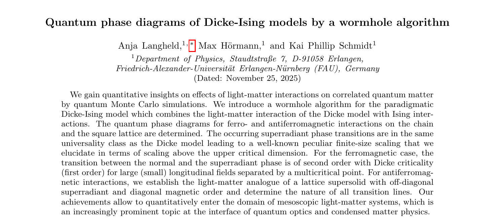

- 论文报告：作者提出一种针对含单模玻色场的自旋—玻色模型的量子蒙特卡洛方法。核心做法是先精确积分掉玻色自由度，把它转化为虚时间上非局域、空间上全连接的延迟自旋相互作用，再用新的虫洞更新高效采样。作者据此计算了一维链和二维方格晶格的 Dicke–Ising 模型零温相图。
- 作者解释：传统世界线更新面对非局域作用时效率低；虫洞更新把延迟作用的两个时间端点同时纳入更新，避免显式截断光子 Hilbert 空间。
- 我的理解：这篇论文有两条主线。方法线是“积掉光子 + 延迟顶点 + 非局域簇更新”；物理线是纵向 Ising 相互作用如何重塑平衡 Dicke 超辐射量子相变。
- 范围边界：论文研究的是封闭系统哈密顿量的平衡基态相图，不是受驱动开放腔中的稳态相变。若把模型映射到量子模拟器，得到的是有效哈密顿量的基态性质，不能直接当成真实腔 QED 材料中的热力学超辐射相变。

#### 对话式详细解读

摘要实际上按“问题—工具—结果—意义”四层推进。

第一层是问题。作者要问的不是单独的 Dicke 模型何时超辐射，而是：当自旋本身已经通过 Ising 相互作用形成强关联时，再把所有自旋共同耦合到一个光子模，会出现哪些新的基态和量子相变？这使问题同时包含两个彼此竞争的有序机制：最近邻 $J\sigma_i^z\sigma_j^z$ 希望自旋沿 $z$ 轴排列，集体光场则通过 $\sigma^x$ 通道诱导横向极化和宏观光子占据。

第二层是工具。困难来自光子模的 Hilbert 空间无穷维，以及把光子积掉后产生的虚时间非局域性。作者不是截断光子数后做有限矩阵计算，而是利用光子部分为高斯型这一点将其精确积分，之后只采样自旋。所谓“虫洞”是蒙特卡洛更新路径可以在延迟顶点的两个虚时间端点之间跳跃，并且在本文的公共光子模情形下还能跳到任意另一个自旋位置。

第三层是结果。摘要已经预告了全文最重要的三个物理结论：

1. 所有连续的正常—超辐射转变都属于纯 Dicke 模型的长程平均场普适类；
2. 铁磁模型在小纵场处是一阶、大纵场处是连续转变，两者由多临界点分开；
3. 反铁磁模型出现同时具有交错磁序和超辐射序的 AS 相，作者把它称作“晶格超固体的光—物质类比”。

第四层是意义。“定量进入介观光—物质系统”指算法可处理多达数千个自旋，从而不再只依赖经典自旋或无限维平均场。不过这里的“定量”仍然是针对式（1）这一有效平衡哈密顿量；它没有自动解决特定实验平台中的规范一致性、$A^2$ 系数、损耗和驱动问题。

#### 读完这一段应带走什么

这篇论文不是单纯报告一张相图，也不是只介绍一种算法。算法上的非局域更新使作者能够检验以往平均场相图；而相图又反过来展示算法为什么值得发展。后面阅读时应始终把“数值方法是否可靠”和“物理相界是什么”两条证据链分开跟踪。

- 个人想法：
- 问题：

### 第 1 步补充：引言——为什么现有算法不够

- 原文定位：主文第 1 页，引言。

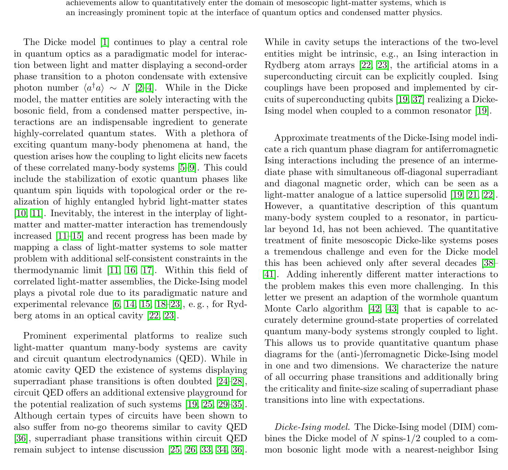

- 论文报告：作者将工作置于 Dicke 模型、量子临界性和符号无问题量子蒙特卡洛的背景下，强调连续玻色模导致无穷维局域空间，而积掉玻色模又会产生虚时间非局域作用。
- 我的理解：作者并非只为一个特定相图设计技巧，而是试图建立适用于一类自旋—玻色模型的通用采样框架。论文的算法价值与具体相图结果同等重要。
- 阅读提醒：后文所谓“超辐射”是平衡哈密顿量基态中的光子宏观占据及相应对称性破缺。

#### 对话式详细解读

引言先从纯 Dicke 模型出发：纯模型中物质单元只通过公共光场相互作用，而凝聚态问题通常还存在不可忽略的物质—物质相互作用。于是本文的研究动机可以改写为：“光不是只给一个已有体系加微扰，而可能与局域关联共同选择新的量子基态。”

作者随后给出实验语境：候选平台包括腔 QED、Rydberg 原子阵列和超导电路。这里应注意作者同时承认超辐射相变的 no-go 争议，并没有宣称所有平台都能直接实现式（1）。补充材料的 $A^2$/TRK 讨论正是对这一限制的后续回应。

接下来是已有工作的缺口。此前已经有一维 $\epsilon=0$ 的定量结果、若干平均场研究以及旋波近似下的 QMC，但对任意纵场、任意 $J$、尤其二维体系还缺少无偏相图。某些变分平均场还预测所有相关转变均为连续，这与一维 $\epsilon=0$ 已知的一阶转变冲突。因此作者需要一种既能处理公共光子模，又能保留局域量子关联的算法。

反铁磁 AS 相被类比为晶格超固体，是因为它同时具有“对角”的交错磁序和“非对角”的超辐射序。但作者在主文第 2 页专门提醒：传统晶格超固体破缺连续 $U(1)$ 对称性并有无隙模，而这里破缺的是离散对称性。因此这是序参量结构上的类比，不是完整低能理论的等同。

### 第 2 步：模型、参数和对称性

- 原文定位：主文第 2 页，式（1）及其后第一段。

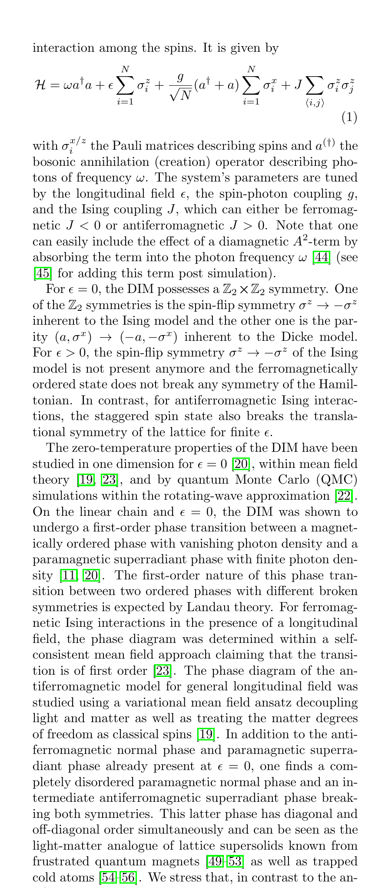

- 论文报告：模型为

$$
H=\omega a^\dagger a+\epsilon\sum_i\sigma_i^z+
\frac{g}{\sqrt N}(a^\dagger+a)\sum_i\sigma_i^x+
J\sum_{\langle i,j\rangle}\sigma_i^z\sigma_j^z .
$$

  其中 $a^\dagger,a$ 为单模光子的产生与湮灭算符；$\omega$ 是光子频率；$\epsilon$ 是自旋能级劈裂的一半；$g$ 是具有 $1/\sqrt N$ 热力学标度的集体光—物质耦合；$J<0$ 为铁磁 Ising 耦合，$J>0$ 为反铁磁 Ising 耦合；$N$ 是自旋数。全文取 $\hbar=1$，能量通常以 $\omega$ 或 $|J|$ 为单位。
- 对称性：一般情况下保留联合变换 $a\rightarrow-a$、$\sigma_i^x\rightarrow-\sigma_i^x$ 的一个 $\mathbb{Z}_2$ 奇偶对称性；在 $\epsilon=0$ 时还具有 $\sigma_i^z\rightarrow-\sigma_i^z$ 的额外自旋翻转对称性，形成 $\mathbb{Z}_2\times\mathbb{Z}_2$。
- 我的理解：$J$ 促进沿 $z$ 方向的（反）铁磁秩序，而光场通过集体 $\sigma^x$ 通道促进横向有序和光子凝聚，两类非对易倾向的竞争产生多相区与多临界结构。
- 容易混淆之处：式（1）中的 $\epsilon$ 不是完整两能级间隔；按作者的 $\epsilon\sigma^z$ 约定，单个无相互作用自旋的能级差是 $2\epsilon$。

#### 逐项拆解哈密顿量

1. $\omega a^\dagger a$ 是单个公共光子模的自由能。本文不是每个格点一个局域玻色模，而是所有自旋共享同一个零动量模。
2. $\epsilon\sum_i\sigma_i^z$ 是纵场项。因为 $\epsilon>0$，单个自旋取 $\sigma_i^z=-1$ 时能量较低；从下翻到上需要能量 $2\epsilon$。
3. $\frac{g}{\sqrt N}(a^\dagger+a)\sum_i\sigma_i^x$ 是集体光—物质耦合。$1/\sqrt N$ 不是把耦合变弱的随意选择，而是保证集体矩阵元随 $\sqrt N$ 增长时，总能量仍具有正确的热力学标度。
4. $J\sum_{\langle i,j\rangle}\sigma_i^z\sigma_j^z$ 只连接最近邻。$J<0$ 时同向自旋每条键能量更低；$J>0$ 时反向自旋每条键能量更低。

#### 两种竞争为什么会产生丰富相图

$J$ 和 $\epsilon$ 都在 $z$ 基底中对角，而光场耦合使用 $\sigma^x$，所以二者不对易。若只看光子位移的平均效应，公共模会诱导一种均匀的、全连接的 $x$ 向有效耦合；它倾向于让所有自旋形成相同的横向分量。铁磁 $J<0$ 时，竞争主要发生在 $z$ 向铁磁序和 $x$ 向集体序之间。反铁磁 $J>0$ 时，系统还可以在保留交错 $z$ 序的同时产生均匀 $x$ 分量，于是出现 AS 共存相。

#### 对称性与相变含义

一般 $\epsilon>0$ 时只剩 Dicke 奇偶对称性

$$
(a,\sigma_i^x)\longrightarrow(-a,-\sigma_i^x).
$$

超辐射相选择两个相反光场位移之一，因此破缺这个 $\mathbb Z_2$。在 $\epsilon=0$ 时还存在全局 $z$ 自旋翻转 $\sigma_i^z\to-\sigma_i^z$。对反铁磁体系，即使 $\epsilon>0$ 已显式破坏全局自旋翻转，交错排列仍破坏一个格点平移对称性，所以 AN/AS 与 PN/PS 之间仍可有真正的磁相变。铁磁情形不同：$\epsilon>0$ 已经选定 $z$ 磁化方向，所谓“正常铁磁”不再额外破坏一个对称性。

#### 使用这个模型时的边界

式（1）尚未包含抗磁 $A^2$ 项、腔损耗、外部驱动或多模结构。把它用于真实平衡腔系统前必须说明微观推导和规范；把它用于量子模拟器时，则应明确讨论的是模拟出来的有效哈密顿量基态。

- 个人想法：
- 问题：

### 第 3 步：积分掉光子后得到什么

- 原文定位：主文第 2 页，式（2）–（5）。

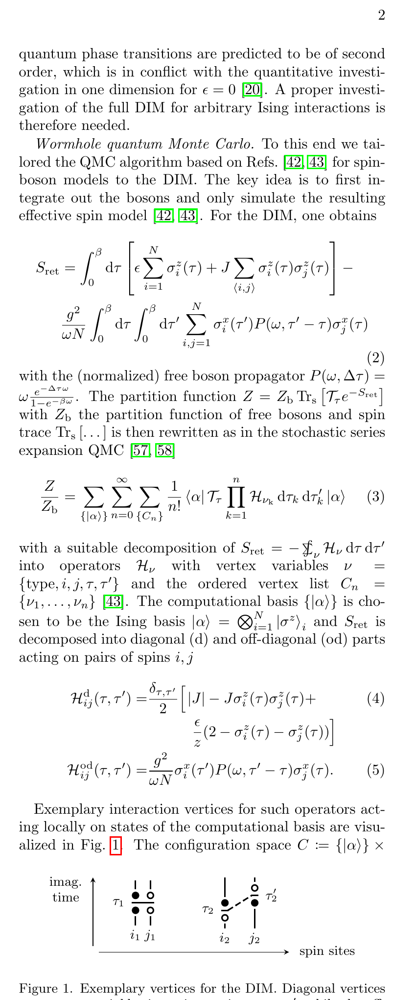

- 论文报告：高斯型光子自由度可被精确积分掉，得到自旋在两个虚时间之间的延迟相互作用。其核由玻色传播子决定，并对所有自旋对求和，因此在空间上是全连接的。
- 核心结构可概括为

$$
S_{\mathrm{ret}}\propto-\frac{g^2}{N}
\sum_{i,j}\int_0^\beta d\tau\,d\tau'\,
\sigma_i^x(\tau)P(\tau-\tau')\sigma_j^x(\tau'),
$$

  其中 $P$ 是满足玻色周期边界条件的有限温传播核，$\beta$ 为逆温。这里的比例式只展示结构；正式归一化和核定义应以原文式（2）为准。
- 作者解释：延迟顶点的两个“腿”分别位于 $\tau$ 和 $\tau'$，虫洞更新允许更新路径从一个端点直接跳到另一个端点，因而能够处理虚时间非局域性。
- 我的理解：算法在自旋与光子之间做了一次表示转换。代价不是近似，而是把显式光子占据转化成双时间顶点；因此不存在人为光子截断误差，但采样器必须正确处理非局域核。
- 方法边界：积分光子在这里是精确步骤；后续统计误差、有限温和有限尺寸误差仍需分别控制。

#### 从光子到延迟相互作用：为什么会出现两个虚时间

光子自由部分是二次型，耦合又只对光子坐标 $a+a^\dagger$ 线性，因此在路径积分中对光子变量做的是高斯积分。这一步没有弱耦合展开。消去光子后，一次自旋翻转在虚时间 $\tau$ 激发光子，另一次在 $\tau'$ 吸收它；两次事件之间由自由光子传播子连接，所以作用量必然含有两个虚时间。

原文采用的有限温传播核为

$$
P(\omega,\Delta\tau)
=\omega\frac{e^{-\omega\Delta\tau}}{1-e^{-\beta\omega}},
\qquad 0\le\Delta\tau<\beta ,
$$

并在补充材料式（S3）中用 $P_{\rm sym}(\omega,\Delta\tau)=[P(\omega,\Delta\tau)+P(\omega,\beta-\Delta\tau)]/2$ 对称化，以便平等处理两个端点。$\omega^{-1}$ 决定虚时间记忆尺度：光子频率越高，核随 $|\tau-\tau'|$ 衰减越快；低频光子产生更长的虚时间记忆。

#### 为什么空间上是全连接

同一个光子模耦合到 $\sum_i\sigma_i^x$。把耦合平方后自然得到 $\sum_{ij}\sigma_i^x(\tau)\sigma_j^x(\tau')$，因此 $i$ 与 $j$ 可以是任意两个格点。$g^2/N$ 保证虽然自旋对有 $N^2$ 个，总相互作用能仍按 $N$ 标度。

#### 式（3）–（5）怎样变成可采样对象

作者在 $\sigma^z$ 基底做随机级数展开（SSE）：

- 对角顶点来自纵场和最近邻 Ising 项，发生在同一虚时间；
- 非对角延迟顶点来自光子介导的 $\sigma_i^x(\tau)\sigma_j^x(\tau')$，同时翻转两个时空点的自旋状态；
- 每个顶点用类型、格点 $i,j$ 和时间 $\tau,\tau'$ 标记，构型就是这些顶点的有序列表。

补充材料式（S5）在对角算符中加入常数平移，使所有允许矩阵元非负。这个常数只平移能谱，不改变本征态，但测量总能量时必须减回去。无符号问题不是自动得到的，而依赖本文的基底、二分格点结构和权重分解。

#### “虫洞”在这里具体做什么

普通有向环更新沿同一格点的虚时间世界线传播。延迟顶点有两个相距很远的端点，更新头进入一个端点后可直接从另一个端点出来；由于公共模连接任意 $i,j$，它还可能同时跳到另一个空间位置。这种跳跃只是构型空间中的采样操作，不是哈密顿量中新出现的真实动力学过程。

#### 这一步的收益与代价

收益是完全避免选择最大光子数截断，尤其适合接近超辐射区、光子数随系统尺寸增长的情形。代价是作用在虚时间和空间上都非局域，必须使用专门更新、数据结构和有限温收敛检查；“精确积掉光子”不意味着最终 QMC 数据没有误差。

- 个人想法：
- 问题：

### 第 4 步：观测量与临界性如何判定

- 原文定位：主文第 2–3 页，式（6）及临界标度讨论。

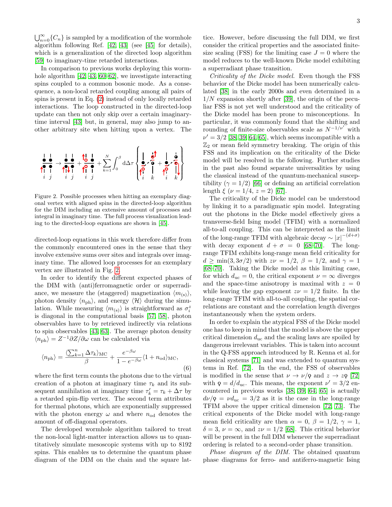

- 论文报告：作者测量均匀或交错的 $z$ 向磁化、相应 Binder 比和光子密度等量。光子已被积分掉，但 $\langle a^\dagger a\rangle$ 仍可由自旋关联函数重建，具体估计量见原文式（6）。
- 超辐射判据：热力学极限中 $n_{\mathrm{ph}}/N$ 非零表示宏观光子占据；需要结合有限尺寸标度和奇偶对称性破缺理解，不能把有限系统中非零的 $\langle a^\dagger a\rangle$ 本身当成相变证据。
- 论文报告：Dicke 临界点可映射到全连接横场 Ising 临界性。作者列出热力学临界指数 $\alpha=0$、$\beta=1/2$、$\gamma=1$、$\delta=3$、$\nu=\infty$、$z=0$，并强调 $z\nu=1/2$；在量子有限尺度标度中使用伪相关长度指数 $\nu'=3/2$。
- 我的理解：$\nu'$ 是高于上临界维数时用于有限尺寸塌缩的指数，不等于通常由空间关联长度发散定义的 $\nu$。解读数值塌缩时必须保留这个区分。

#### 观测量分别回答什么问题

磁序直接在 $\sigma^z$ 基底中测量。铁磁时看均匀磁化，反铁磁时看交错磁化

$$
m_s=\frac{1}{N}\sum_i(-1)^i\sigma_i^z ,
$$

以及它的平方或 Binder 比。交错序非零区分 AN/AS 与 PN/PS；它并不能单独判断是否超辐射。

超辐射性由光子密度的热力学标度判断。有限系统即使处在正常相也可有虚光子，所以关键不是 $\langle n_{\rm ph}\rangle$ 是否严格为零，而是 $\langle n_{\rm ph}\rangle/N$ 在 $N\to\infty$ 是否趋于有限值，并且是否伴随 Dicke 奇偶对称性的自发破缺。

能量主要用来诊断一阶转变：两个相的基态能量分支交叉会产生斜率不连续。只看序参量突跳容易受亚稳态和扫描方向影响，能量分支提供更直接的平衡判据。

#### 光子已经被积掉，为什么还能测光子数

原文式（6）把 $\langle n_{\rm ph}\rangle=Z^{-1}\partial Z/\partial\omega$ 写成构型统计量。第一项统计延迟自旋翻转顶点的两个端点间隔 $\Delta\tau_k$，对应虚光子的产生与随后湮灭；第二项含 Bose 因子 $e^{-\beta\omega}/(1-e^{-\beta\omega})$，对应热光子并在低温指数压低。也就是说，光子自由度虽然不在采样构型中显式出现，它们对配分函数的响应仍编码在顶点数和虚时间间隔里。

#### 为什么 Dicke 临界性不是普通短程 Ising 临界性

积分光子后得到的是归一化的全连接 $x$ 向耦合。作者把它视为长程横场 Ising 模型 $1/r^{d+\sigma}$ 在 $d+\sigma=0$ 的极限。空间相关在任意两点之间都不随距离衰减，系统一旦有序，通常意义的空间关联长度相当于瞬间发散，因此得到 $\nu=\infty$、$z=0$，但能隙指数乘积 $z\nu=1/2$ 仍有限。

这类模型处于上临界维数之上，危险无关变量会修改有限系统的尺度变量。实际数据的临界点漂移和圆整按 $N^{-1/\nu'}$，其中 $\nu'=3/2$。因此：

- $\nu=\infty$ 描述热力学长程模型的空间关联性质；
- $\nu'=3/2$ 是用系统总自由度 $N$ 做 Q-FSS 时出现的有限尺寸指数；
- 两者并不矛盾，也不应把 $\nu'$ 解释成普通有限维系统的空间关联长度指数。

#### 怎样看后面的数据塌缩

对于光子密度，作者使用类似

$$
N^{2\beta/\nu'}\langle n_{\rm ph}\rangle
=F\!\left(N^{1/\nu'}(g-g_c)\right)
$$

的标度形式（具体采用 $L$ 或 $N$ 取决于图中记号）。如果不同尺寸数据在同一 $g_c$ 和指数下落到一条曲线，才支持连续 Dicke 临界性。拟合数值接近 $\beta=1/2$、$\nu'=3/2$ 是普适类证据，不只是相界位置的拟合。

#### 数值尺度

作者报告最多模拟 $N=8192$ 个自旋。这对全连接延迟作用已经是介观大系统，但仍需检查低温收敛和有限尺寸窗口；最大尺寸大并不自动排除多临界点附近的弱一阶行为。

- 个人想法：
- 问题：

### 第 5 步：铁磁和反铁磁相图

- 原文定位：主文第 3–4 页，图 3、图 4。

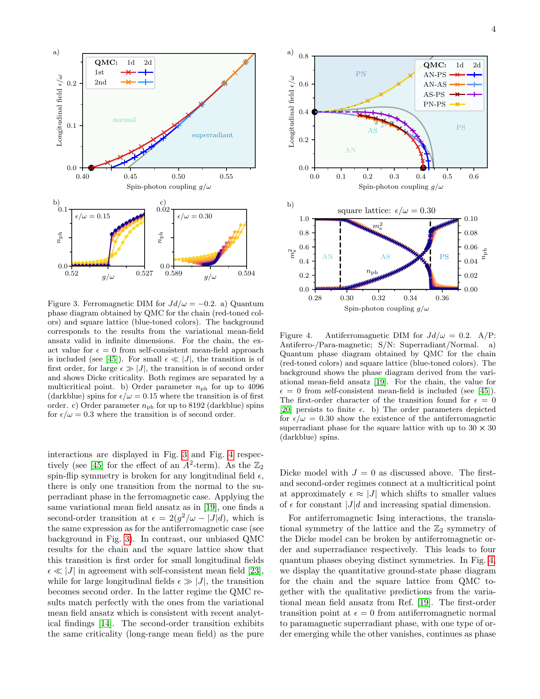

- 铁磁结果（图 3）：在 $J<0$ 时，低 $\epsilon$ 区域的正常铁磁相与超辐射相之间存在一阶边界；较大 $\epsilon$ 时过渡转为连续的 Dicke 型量子相变。两类边界在约 $\epsilon\simeq |J|$ 附近相接，形成多临界结构。
- 反铁磁结果（图 4）：作者区分反铁磁正常相（AN）、顺磁正常相（PN）、反铁磁超辐射相（AS）和顺磁超辐射相（PS）。AS 同时具有交错 $z$ 向秩序和超辐射序，是两种序的共存相。
- 方格晶格：AS–PS 边界在较弱光—物质耦合 $g/\omega\lesssim0.30(2)$ 时表现为连续的三维 Ising 普适类，在更强耦合处转为一阶。
- 一维链：作者没有发现 AS–PS 边界存在连续转变的证据；数值结果支持该边界为一阶。
- 我的理解：Dicke 型相变主要破缺光—物质联合奇偶对称性；AS–PS 则消失的是反铁磁交错序。不同序参量控制不同边界，因此不能把相图中的所有连续线统称为“Dicke 普适类”。

#### 图 3：铁磁相图应怎样读

图 3(a) 的横轴是 $g/\omega$，纵轴是 $\epsilon/\omega$，固定 $Jd/\omega=-0.2$，其中 $d$ 是空间维数。红色系 QMC 点对应一维链，蓝色系对应二维方格晶格；背景色是无限维变分平均场结果，不是 QMC 数据。不同颜色/线型区分一阶和二阶相界。

平均场给出连续边界

$$
\epsilon=2\left(\frac{g^2}{\omega}-|J|d\right),
$$

但无偏 QMC 表明它只在较大纵场区域正确。小 $\epsilon\ll|J|$ 时，正常的 $z$ 向磁有序态与超辐射态通过能量交叉直接切换，是一阶转变；大 $\epsilon\gg|J|$ 时，光子密度从零连续长出，临界性回到纯 Dicke 模型。两段约在 $\epsilon\simeq|J|$ 附近接合，并且固定 $|J|d$ 时维数升高会把多临界点推向较小 $\epsilon$。

图 3(b) 和 3(c) 不是两张重复的序参量曲线。$\epsilon/\omega=0.15$ 时，最多 $N=4096$ 的光子密度在临界附近显示一阶特征；$\epsilon/\omega=0.30$ 时，最多 $N=8192$ 的数据呈连续转变。它们分别给图 3(a) 的两种线型提供代表性原始证据。

#### 图 4：四个反铁磁相分别意味着什么

| 相 | 交错 $z$ 磁序 | 宏观光子占据 | 破缺的主要对称性 |
| --- | --- | --- | --- |
| AN | 有 | 无 | 格点平移 |
| PN | 无 | 无 | 无自发破缺 |
| AS | 有 | 有 | 格点平移与 Dicke 奇偶 |
| PS | 无 | 有 | Dicke 奇偶 |

图 4(a) 同样以 QMC 点覆盖在变分平均场背景上，固定 $Jd/\omega=0.2$。从小 $g$ 增大时，某些纵场截面会先从 AN 进入 AS：光场已经超辐射，但交错磁序尚未熔化；继续增大 $g$ 才进入 PS。这正是中间共存相出现的物理图像。

图 4(b) 取方格晶格 $\epsilon/\omega=0.30$，同时画出 $m_s^2$ 和 $n_{\rm ph}$。在 AN→AS 处，光子密度出现而交错磁序仍存在；在 AS→PS 处，交错磁序消失而系统仍保持超辐射。两次转变由不同序参量控制，不能用同一套临界指数描述。

#### 为什么维数会改变 AS–PS 边界

AN–AS 和 PN–PS 是超辐射序出现的边界，连续时受全连接光场通道控制，属于 Dicke 长程平均场普适类。AS–PS 则在已经超辐射的背景中熔化交错 Ising 序，低能问题更接近带纵场的反铁磁横场 Ising 模型。二维量子体系对应三维经典 Ising 普适类，因而方格晶格存在连续段；一维预期若连续应接近二维 Ising 类，但本文 QMC 在整个可见相图中都没有找到连续证据，只观察到逐渐变弱的一阶能量交叉。

#### “光—物质晶格超固体”应该怎样理解

AS 同时有对角磁序和非对角超辐射序，因此在序参量层面类似晶格超固体。不过这里的超辐射只破缺离散 $\mathbb Z_2$，传统超固体往往破缺连续 $U(1)$ 并有 Goldstone 模。因此最好写成“类比”或“对应物”，不应直接声称二者具有相同低能激发。

- 个人想法：
- 问题：

### 第 6 步：主文结论——哪些结果最值得带走

- 原文定位：主文第 5 页，结论部分。

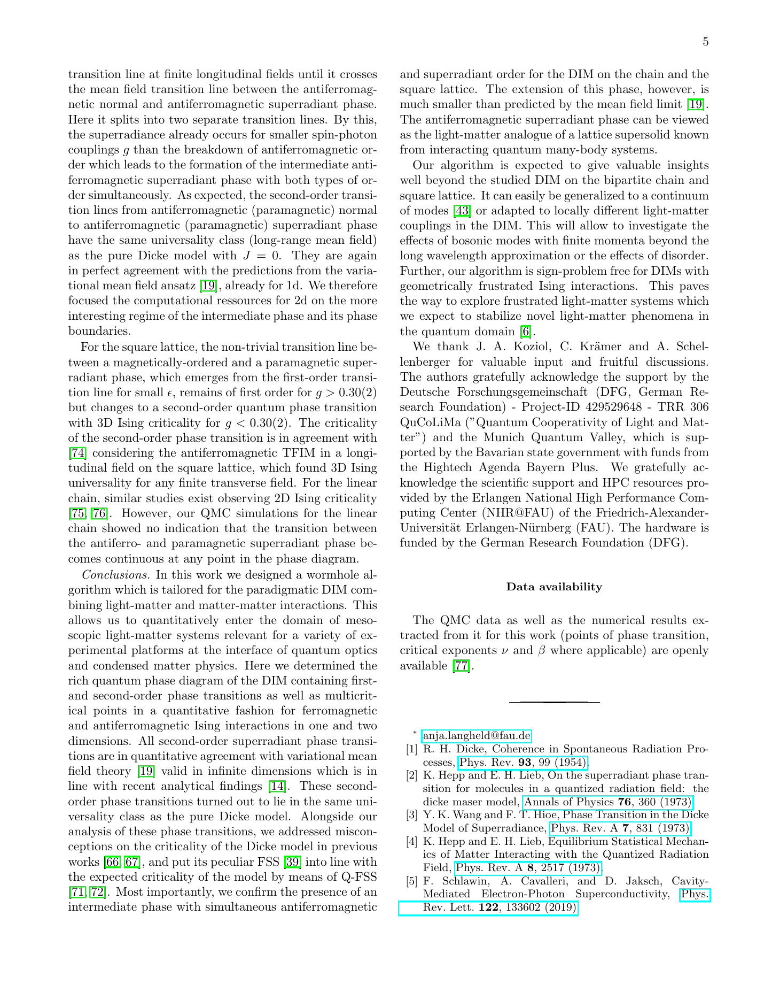

- 论文报告：虫洞算法能无截断地处理光子，并可在大系统和低温下研究一维、二维 Dicke–Ising 模型。相图同时包含一阶与连续 Dicke 转变、反铁磁与超辐射共存相，以及维数相关的 AS–PS 临界行为。
- 作者解释：自旋局域相互作用不仅移动临界耦合，还会改变相边界的阶数和多临界结构。
- 我的理解：这篇论文最可靠的用途有三类：作为模型相图基线；作为有限尺度标度与临界指数的数值参照；作为不显式截断玻色空间的算法范例。它并未直接建立特定实验平台的微观参数映射。
- 不应外推：主文相图本身未含耗散、泵浦或测量反馈。因此它不能直接预测开放系统的稳态阈值，也不能把有效模型中的基态 AS 相直接等同于真实材料中的平衡超辐射相。

#### 结论部分实际上确认了什么

第一，作者用一套无偏 QMC 同时覆盖铁磁/反铁磁、一维/二维以及一阶/连续转变，纠正了部分经典自旋或变分平均场对相变阶数的判断。尤其是铁磁小纵场的一阶段，以及反铁磁共存相实际远小于平均场预测，都是量子涨落不可忽略的体现。

第二，作者不仅给出相界，还解释了连续超辐射转变的有限尺寸标度。把 $\nu'=3/2$ 放回上临界维数以上的 Q-FSS 框架，是论文的概念贡献之一；它处理了以往把不同“相关长度”定义混在一起造成的误解。

第三，反铁磁 AS 相在链和方格晶格上都被定量确认，但 AS–PS 边界的阶数具有明显维数依赖。二维存在 3D Ising 连续段，一维数据未显示连续段。这说明“共存相存在”与“共存相怎样消失”是两个不同问题。

#### 作者明确提出的扩展方向

虫洞框架可推广到多模或连续模、空间不均匀的光—物质耦合、有限动量光子以及无序。作者还指出其权重构造对几何受挫 Ising 相互作用可保持无符号问题，为受挫光—物质体系提供了数值入口。这些是算法潜力，不是本文已经计算出的物理结果。

#### 对毕业设计最有用的阅读结论

本文可以作为不含 $A^2$ 时的零温相图基准，并通过补充材料的参数重整化讨论 $A^2$ 后的可达性。若毕业设计研究“反压缩项、Ising 关联与 TRK 约束的联合作用”，真正需要接着做的不是重复整张相图，而是：

1. 明确微观平台给出的 $D(g)$ 和规范约束；
2. 建立正常相的响应/失稳条件，解释 $J>0$ 为什么能移动 no-go 边界；
3. 检查反压缩或其他二次光子项是否只产生参数重整化，还是改变稳定性和临界结构；
4. 将零温结果与有限温行为分开，不能把本文结论直接延伸到有限温。

- 个人想法：
- 问题：

### 第 7 步：虫洞算法的更新机制

- 原文定位：补充材料第 S1–S5 页，式（S17）–（S19）、表 I、图 S3。

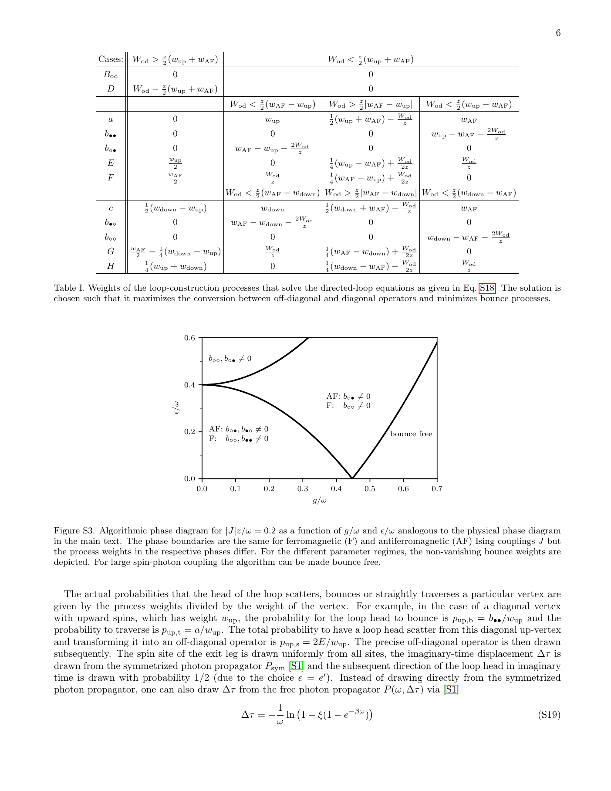

- 论文报告：作者把延迟相互作用拆成带两个虚时间端点的顶点，构造满足详细平衡的局域散射概率。当更新头遇到延迟顶点时，可以从一个端点“穿越”到另一个端点，再继续沿世界线传播。
- 表 I 的作用：列出不同顶点构型和对应权重，是实现无拒绝或低拒绝更新时的局部详细平衡依据。式（S17）–（S19）给出具体权重关系。
- 图 S3 的性质：它展示的是算法参数/更新方案的有效区域，不是模型的物理相图。引用时必须避免将它误称为量子相图。
- 复杂度：作者给出的实现复杂度为 $O(\beta N\log\beta)$，其中对数因子来自虚时间对象的检索或维护。
- 我的理解：虫洞不是新增的物理过程，而是蒙特卡洛构型空间中的非局域更新通道。它改变采样效率，不改变目标配分函数。

#### 构型权重是怎样建立的

补充材料先把最近邻键改写成对每个格点及其 $z$ 个邻居求和，因此每条键会被数两次，式（S2）相应使用 $J/2$。之后在 $\sigma^z$ 基底把作用量分成两类非分支算符：

$$
H_{ij}^{d}(\tau,\tau')
=\frac{\delta_{\tau,\tau'}}{2}
\left[|J|-J\sigma_i^z\sigma_j^z
+\frac{\epsilon}{z}(2-\sigma_i^z-\sigma_j^z)\right],
$$

$$
H_{ij}^{od}(\tau,\tau')
=\frac{g^2}{\omega N}
\sigma_i^x(\tau)P_{\rm sym}(\omega,\tau-\tau')\sigma_j^x(\tau').
$$

这里的“非分支”是指算符作用在某个 $\sigma^z$ 基矢后只得到另一个确定基矢，不产生叠加。这样每个允许局域构型都有一个非负标量权重，SSE 才能把配分函数写成对顶点列表的统计求和。

#### 一次蒙特卡洛扫描包含什么

算法交替进行：

1. 对角更新：在有序顶点列表中插入或删除由纵场/Ising 项产生的对角顶点，接受率由式（S15）、（S16）的 Metropolis–Hastings 比决定；
2. 虫洞更新：把对角顶点转换成延迟非对角顶点，或反向转换，并沿更新环翻转所经过的自旋段。

普通对角顶点只连接最近邻且两个端点在同一 $\tau$；非对角顶点可连接任意两个自旋，并有两个不同虚时间。更新头进入非对角顶点后，可以从另一时空坐标继续，这就是“虫洞”跳跃。

#### 为什么全连接作用没有让转换概率随 $N$ 消失

每一个具体非对角顶点权重含 $1/N$，看起来系统越大越难生成。但从某个对角顶点出发，可以选择的目标格点有 $N$ 个。作者在有向环方程中显式对所有目标格点和虚时间积分，$N$ 个可能过程抵消单个顶点的 $1/N$，使对角↔非对角的总转换概率在大系统下仍为 $O(1)$。这是该算法能扩展到数千自旋的关键设计。

#### 式（S17）–（S19）和表 I 分别做什么

式（S17）列出局部详细平衡：某个入射顶点的总权重必须等于所有可能散射过程的权重和。作者利用平移不变性、时间反向等价以及从传播核直接抽样 $\Delta\tau$ 等选择，把它简化为式（S18）。

表 I 给出一组具体解，目标是最大化对角/非对角顶点之间的转换并最小化 bounce。不同参数区所需的非零 bounce 权重不同，于是形成图 S3 的“算法相图”。它只回答采样器在哪些参数下可做到无反弹，不表示系统出现了新物相。

式（S19）

$$
\Delta\tau=-\frac{1}{\omega}
\ln\!\left[1-\xi(1-e^{-\beta\omega})\right]
$$

用均匀随机数 $\xi\in[0,1)$ 直接从自由光子传播子抽取时间间隔，再以相同概率选择 $\tau'=\tau\pm\Delta\tau$。这样提议分布已经包含核的相对权重，可降低接受率波动。

#### 数据结构为什么带来 $\log\beta$

顶点在更新中会改变格点和虚时间，不能像传统实现那样预先固定每条世界线的链接。作者为每个格点维护顺序统计树和按虚时间排序的映射，以 $O(\log\beta)$ 查找、插入和删除相邻顶点。基本顶点数按 $\beta N$ 增长，所以总复杂度是 $O(\beta N\log\beta)$。作者也承认排序结构占据了显著运行时间；这一复杂度是实际实现的结果，不是算法不可改进的理论下界。

- 个人想法：
- 问题：

### 第 8 步：如何区分一阶和二阶相变

- 原文定位：补充材料第 S6–S7 页，图 S4。

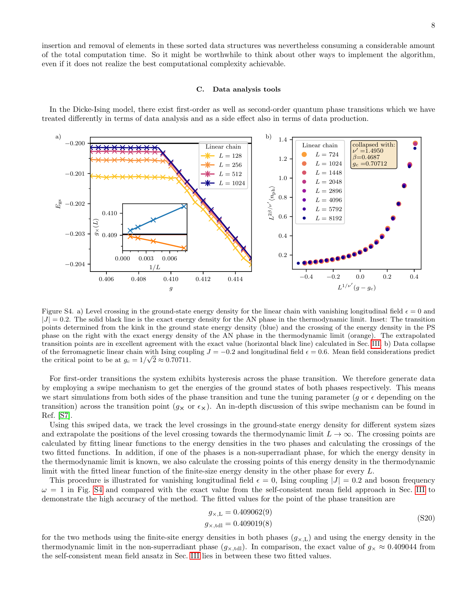

- 一阶证据：作者观察能级交叉/能量分支和滞回行为。一阶边界附近亚稳态使简单平衡采样困难，因此通过从边界两侧初始化并比较分支来定位交叉。
- 连续转变证据：作者使用有限尺度数据塌缩，并把拟合指数与 Dicke 的 $\nu'=3/2$、$\beta=1/2$ 比较。
- 数值基准：在 $\epsilon=0$、$|J|=0.2$、$\omega=1$ 的铁磁算例中，QMC 给出有限尺寸交叉点 $g_{\times,L}=0.409062(9)$、外推 $g_{\times,\mathrm{tdl}}=0.409019(8)$，与精确值约 $0.409044$ 一致。另一连续转变算例 $J=-0.2$、$\epsilon=0.6$ 得到 $\nu'=1.4950$、$\beta=0.4687$、$g_c=0.70712$，接近期望的 $1.5$、$0.5$ 和 $1/\sqrt2$。
- 我的理解：第一组比较验证一阶线定位；第二组验证连续线的有限尺度标度。两者共同支撑相图判据，而不是只凭某一个序参量的肉眼突变。

#### 一阶转变：为什么要双向 swipe

一阶相变附近存在两个局域稳定构型。有限时间 QMC 往往停留在初始化所在的相，直接从随机态运行可能把亚稳分支误当成平衡结果。作者从相界两侧分别初始化，逐步扫描 $g$ 或 $\epsilon$ 穿过相界，得到两条具有滞回的能量分支。这种滞回是寻找亚稳分支的数值工具；真正的平衡转变点是两相基态能量相等的位置，而不是扫描曲线开始跳变的位置。

对每个系统尺寸，作者在线性交叉附近分别拟合两相的能量密度并求交点，再把交点外推到 $L\to\infty$。如果正常相的热力学能量已知，还可以直接让有限尺寸超辐射分支与该精确能量相交，得到第二种估计。

图 S4(a) 用 $\epsilon=0$、$|J|=0.2$、$\omega=1$ 的一维链检验这套流程。两种外推分别给

$$
g_{\times,L}=0.409062(9),\qquad
g_{\times,\mathrm{tdl}}=0.409019(8),
$$

而自洽精确基准约为 $0.409044$，正好位于两者之间。括号是不确定度的末位数字，不应被忽略。

#### 连续转变：数据塌缩同时检验临界点和普适类

图 S4(b) 取铁磁链 $J=-0.2$、$\epsilon=0.6$、$\omega=1$，系统尺寸从 $L=724$ 到 $8192$。作者调节 $g_c,\beta,\nu'$，使不同尺寸的重标度光子密度落在统一曲线上，得到

$$
\nu'=1.4950,\qquad \beta=0.4687,\qquad g_c=0.70712.
$$

它们分别接近 Dicke 值 $3/2$、$1/2$ 以及平均场位置 $1/\sqrt2\simeq0.70711$。这里 $\beta$ 是序参量临界指数，不是逆温；正文和代码中必须通过上下文区分。

#### 两种诊断各自可能误判什么

- 能量 kink 在接近多临界点时会变得极平，并被有限尺寸圆滑化；看不见明显尖点不等于连续。
- 数据塌缩对所选尺寸和临界窗口敏感；弱一阶转变在小尺寸上也可能给出貌似不错的塌缩。
- 因此作者在多临界区同时检查能量、能量导数、滞回、序参量塌缩以及拟合指数漂移。

这正是补充材料图 S5–S8 的作用：它们不是额外装饰，而是相变阶数分类的证据链。

- 个人想法：
- 问题：

### 第 9 步：多临界位置与普适类

- 原文定位：补充材料第 S8–S10 页，图 S5–S8。

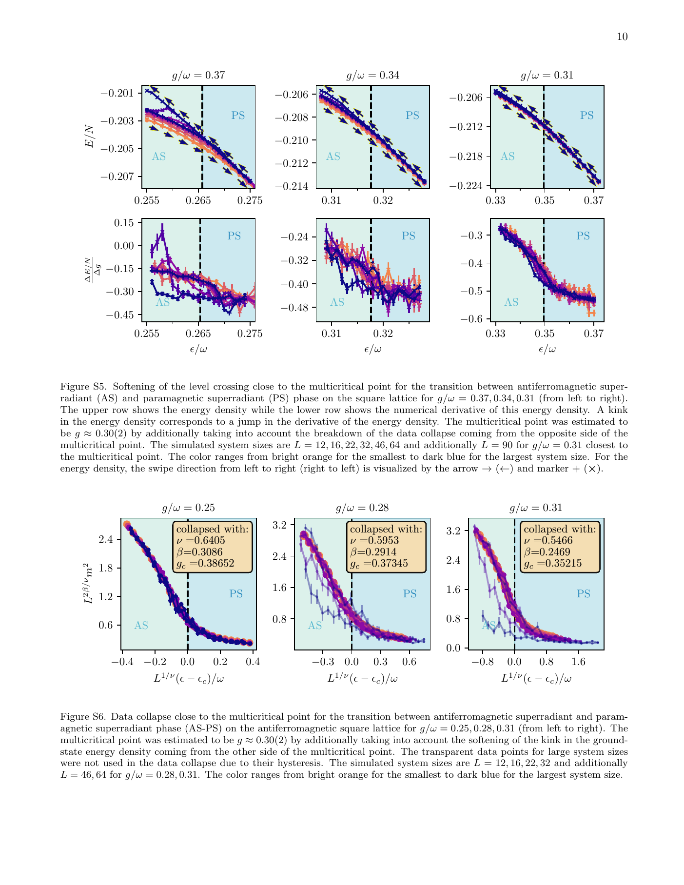

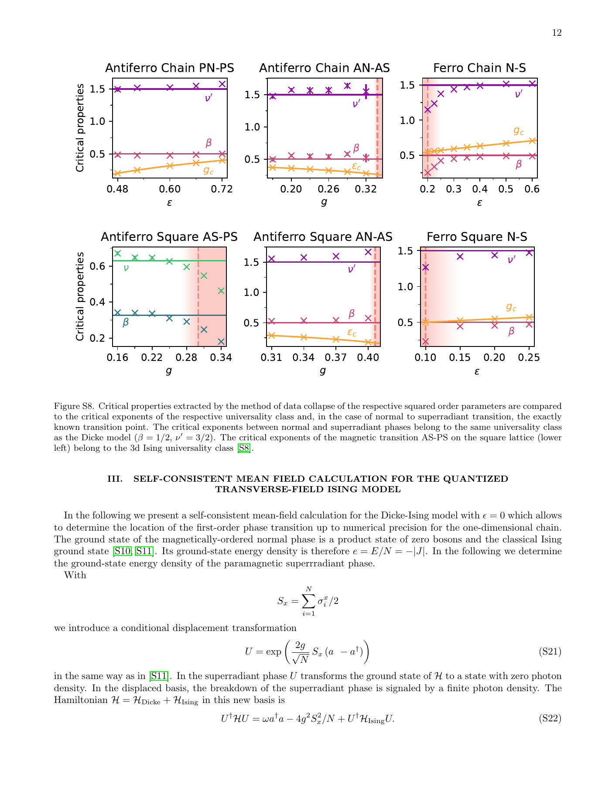

- 论文报告：方格晶格 AS–PS 边界的连续段与一阶段在 $g/\omega\simeq0.30(2)$ 附近相接。作者用能量和序参量行为判断强耦合一侧为一阶，并指出靠近端点时弱一阶转变可能很难与连续转变区分。
- 普适类核对：Dicke 边界采用平均场/全连接临界指数和 $\nu'=3/2$ 的量子有限尺度标度；二维量子反铁磁 AS–PS 连续边界对应三维经典 Ising 普适类，参考 $\beta\approx0.326$、$\nu\approx0.630$。
- 我的理解：多临界点附近同时存在较大的有限尺寸修正和亚稳性。$0.30(2)$ 应作为带不确定度的数值估计，而非精确常数。

#### 从一阶一侧逼近多临界点：图 S5

图 S5 固定方格晶格的 $g/\omega=0.37,0.34,0.31$，扫描 $\epsilon/\omega$ 穿过 AS–PS 边界。上排画能量密度，下排画数值导数。$g/\omega=0.37$ 时 kink 和导数跳跃清楚；到 $0.34$ 只在最大尺寸看见很小滞回；$0.31$ 时能量肉眼已经近似光滑，但导数仍保留微小滞回/不连续。

最靠近端点的数据用了最大 $L=90$，即 $N=8100$。即使如此，一阶信号仍很弱，这说明 $g/\omega\simeq0.30(2)$ 的误差主要不是普通拟合误差，而是“有限尺寸下还能否分辨极弱一阶”的分类不确定性。

#### 从连续一侧逼近：图 S6

图 S6 对 $g/\omega=0.25,0.28,0.31$ 的交错磁化平方做 3D Ising 型塌缩。远离端点的 $0.25$ 给出 $\nu=0.6405,\beta=0.3086$，与 3D Ising 的 $\nu\approx0.630,\beta\approx0.326$ 接近。走向 $0.28$、$0.31$ 时，拟合指数分别漂移到 $(0.5953,0.2914)$ 和 $(0.5466,0.2469)$，曲线互相剪切，大尺寸还出现滞回。作者因此把靠近端点的大尺寸透明数据排除在连续塌缩之外。

“排除大尺寸后还能塌缩”不能证明转变连续；恰恰相反，大尺寸出现滞回和指数系统漂移是靠近一阶区的警告。作者综合图 S5 的能量证据与图 S6 的塌缩失效，把端点估为 $g/\omega\simeq0.30(2)$。

#### 一维链为什么没有报告连续段：图 S7

链上 $g/\omega=0.29,0.23,0.17$ 的能量交叉随 $g$ 下降而软化，但所有模拟数据仍显示能级交叉。最大尺寸达到 $L=2048$，作者没有观察到一条可归入 2D Ising 普适类的连续 AS–PS 线。因此主文采用谨慎措辞：“没有迹象表明它在相图任何位置变连续”，而不是数学上证明整个边界必然一阶。

#### 图 S8 的全局一致性检查

作者把所有连续相界拟合出的临界指数汇总：

- PN–PS、AN–AS 以及铁磁 N–S 等正常—超辐射边界接近 Dicke 的 $\beta=1/2,\nu'=3/2$；
- 方格晶格 AS–PS 连续段接近 3D Ising 指数；
- 接近虚线标出的多临界点时，指数开始偏离，进入红色模糊区域后数据塌缩已不适用。

因此普适类的判断不是来自单个漂亮截面，而是来自整条相界上指数的系统行为。红色区域的模糊边缘也直观表示多临界位置的分类不确定度。

#### 我们应如何引用这个数值

可以写“作者估计连续 AS–PS 线在 $g/\omega\simeq0.30(2)$ 附近终止”，不宜写“临界耦合精确等于 0.30”。还应说明这是固定 $Jd/\omega=0.2$ 的方格晶格截面，不是任意参数下的普适常数。

- 个人想法：
- 问题：

### 第 10 步：自洽理论与一维精确基准

- 原文定位：补充材料第 S11–S14 页，式（S21）–（S32）。

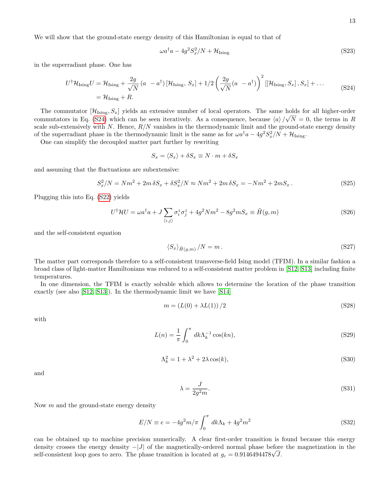

- 论文报告：作者通过条件位移变换把光场位移与自旋的均匀 $x$ 向期望值联系起来，从而得到自洽的横场 Ising 问题。该方法为相边界提供解析或半解析基准。
- 一维基准：在 $\omega=1$ 的相应极限下，作者给出临界耦合

$$
g_c=0.9146494478\sqrt{|J|}.
$$

- 我的理解：自洽处理利用的是集体耦合在热力学极限的平均场性质，但局域 Ising 子系统仍可保留非平庸量子关联。一维精确结果因此是检验 QMC 和近似边界的高精度锚点。
- 适用范围：该推导服务于本文平衡模型；条件位移并没有自动纳入腔损耗、外驱动，也不构成任意实验平台的 TRK 关系。

#### 条件位移变换在做什么

补充材料第 III 节只处理 $\epsilon=0$。作者定义集体自旋

$$
S_x=\frac12\sum_{i=1}^N\sigma_i^x
$$

并作条件位移

$$
U=\exp\!\left[\frac{2g}{\sqrt N}S_x(a-a^\dagger)\right].
$$

直观上，若自旋具有宏观 $x$ 极化，光子振子平衡位置会随 $S_x$ 偏移。$U$ 把这个宏观相干位移吸收到基底中，使变换后超辐射基态的显式光子密度为零。这样光场的静态作用转化为集体自旋项

$$
-\frac{4g^2}{N}S_x^2.
$$

这不是把光子随意删掉，而是先把与集体极化锁定的相干位移精确搬走。

#### 为什么变换后的 Ising 修正可以忽略到能量密度层面

$U^\dagger H_{\rm Ising}U$ 展开后包含

$$
\frac{2g}{\sqrt N}(a-a^\dagger)[H_{\rm Ising},S_x]
$$

及更高阶对易子。每个对易子仍是广延个数的局域算符，但它前面带有 $N^{-1/2}$ 的光子涨落因子。作者论证这些剩余项 $R$ 对总能量至多次广延，因此 $R/N\to0$。结论是：在热力学极限的超辐射相中，基态能量密度可由

$$
\omega a^\dagger a-\frac{4g^2}{N}S_x^2+H_{\rm Ising}
$$

计算。注意这是对能量密度的热力学极限论证，不表示所有有限 $N$ 观测量都完全没有修正。

#### 自洽横场 Ising 模型怎样出现

令

$$
S_x=Nm+\delta S_x,\qquad m=\frac{\langle S_x\rangle}{N},
$$

并假定涨落 $\delta S_x$ 次广延，则

$$
\frac{S_x^2}{N}\approx-Nm^2+2mS_x .
$$

于是物质哈密顿量变成

$$
\widetilde H(g,m)
=J\sum_{\langle i,j\rangle}\sigma_i^z\sigma_j^z
+4g^2Nm^2-8g^2mS_x,
$$

并要求

$$
\frac{\langle S_x\rangle_{\widetilde H(g,m)}}{N}=m.
$$

因此光场生成的横场 $8g^2m$ 又由该横场产生的磁化 $m$ 自洽决定。公共模的集体部分在热力学极限可平均场化，但最近邻 Ising 链本身仍按精确量子模型处理；这比把每个自旋直接当经典矢量的变分平均场更强。

#### 一维精确解如何给出一阶转变点

一维横场 Ising 模型可通过 Jordan–Wigner 方法精确求解。作者把自洽参数写成

$$
m=\frac{L(0)+\lambda L(1)}{2},\qquad
L(n)=\frac1\pi\int_0^\pi\frac{\cos(kn)}{\Lambda_k}\,dk,
$$

$$
\Lambda_k^2=1+\lambda^2+2\lambda\cos k,\qquad
\lambda=\frac{J}{2g^2m},
$$

再计算超辐射分支的能量密度

$$
e=-\frac{4g^2m}{\pi}\int_0^\pi\Lambda_k\,dk+4g^2m^2.
$$

正常磁有序态在 $\epsilon=0$ 的能量密度为 $e_{\rm N}=-|J|$。随着 $g$ 增大，超辐射分支在自洽磁化 $m$ 尚未连续降到零之前就与 $-|J|$ 相交，所以发生的是两条能量分支交叉的一阶转变，而不是序参量连续消失。数值求解给出

$$
g_c=0.9146494478\sqrt{|J|}
$$

（该节采用 $\omega=1$ 的单位约定）。这正是图 S4(a) 用来检验 QMC 一阶定位精度的“精确值”。

#### 这套推导能和不能告诉我们什么

它精确锚定 $\epsilon=0$ 一维热力学极限的相界，并解释为什么转变是一阶。它不直接给任意 $\epsilon$、二维、有限温度或含 $A^2$/反压缩项时的闭式相界；这些情形需要新的自洽方程或数值计算。

- 个人想法：
- 问题：

### 第 11 步：抗磁 $A^2$ 项、TRK 约束与可达相区

- 原文定位：补充材料第 S14–S15 页，式（S33）–（S35）、图 S9。

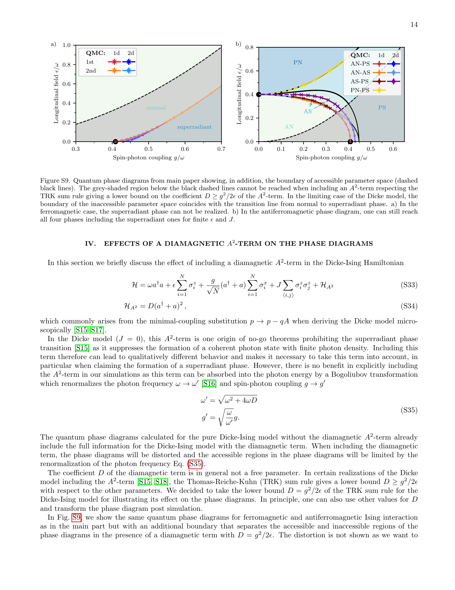

- 论文报告：加入

$$
H_{A^2}=D(a^\dagger+a)^2
$$

  后，可用 Bogoliubov 变换保持 Dicke–Ising 形式，但参数变为

$$
\omega'=\sqrt{\omega^2+4\omega D},
\qquad
g'=g\sqrt{\frac{\omega}{\omega'}}.
$$

- 论文报告：作者以 $D=g^2/(2\epsilon)$ 取其所讨论的 TRK 下界等号，绘制图 S9。铁磁超辐射区完全落在该约束下的不可达区域；反铁磁超辐射区（包括 AS 共存相）仍有部分可达。
- 作者解释：反铁磁相互作用降低正常相中局域自旋激发的能量代价，因此物质侧更容易产生横向响应，超辐射边界可以延伸到 TRK 可达区域。
- 我的分析（不是作者在 §IV 中给出的显式推导）：从完全极化的顺磁正常态出发，翻转一个自旋的纵场代价为 $2\epsilon$；每条反铁磁键由 $+J$ 变为 $-J$，每键降低 $2J$。若配位数为 $z$，最简单的局域估计为

$$
\Delta_{\mathrm{loc}}\approx2(\epsilon-zJ).
$$

  当 $J>0$ 且靠近反铁磁失稳线时，这个能标小于纯 Dicke 模型的 $2\epsilon$，相应横向磁化率增大，所需临界有效耦合降低。因此，即使 $A^2$ 项增大光子刚度并压低重整化后的耦合，物质侧增强的响应仍可能使 AS/PS 相的一部分保留下来。
- 证据边界：上式只是局域激发的机制性估计，不能替代完整关联体系的超辐射失稳条件。本文给出定性解释和数值相图，但未在 §IV 推导显式含 $J$ 的 TRK 受限临界公式。
- 平台边界：$D\ge g^2/(2\epsilon)$ 是作者用于讨论的示例性 TRK 关系，其具体形式依赖微观实现；不能未经核对直接推广到所有电路 QED、磁偶极或量子模拟平台。

#### 第 IV 节的论证路线

补充材料第 IV 节很短，但包含五个连续步骤：

1. 式（S33）、（S34）把抗磁项 $H_{A^2}=D(a^\dagger+a)^2$ 加回 Dicke–Ising 哈密顿量，并说明它通常来自最小耦合替换 $\mathbf p\to\mathbf p-q\mathbf A$；
2. 作者指出纯 Dicke 模型中该项会提高形成相干光场的代价，是平衡超辐射 no-go 定理的来源之一；
3. 式（S35）表明无需重新做 QMC：用 Bogoliubov 变换即可把 $A^2$ 项吸收到重整化后的 $\omega'$ 和 $g'$；
4. 由于 $D$ 在微观模型中不能随意取值，作者采用特定实现中的 TRK 下界 $D\ge g^2/(2\epsilon)$，并取最有利于超辐射的等号；
5. 图 S9 把由此得到的可达性边界叠加到无 $A^2$ 的相图上，再比较各物相是否仍有区域位于边界的可达一侧。

这里有两个逻辑层次：Bogoliubov 变换说明“含 $A^2$ 的模型怎样映射到作者已经算过的相图”；TRK 关系则进一步限制“哪些映射后的相图点能够来自一个物理上允许的裸参数组”。可达区讨论的是第二层。

#### $A^2$ 项为什么抑制超辐射

将光子写成坐标和动量后，$(a+a^\dagger)^2$ 相当于增加振子坐标方向的恢复力。Bogoliubov 变换给出

$$
\omega'=\sqrt{\omega^2+4\omega D}>\omega ,
$$

同时

$$
g'=g\sqrt{\frac{\omega}{\omega'}}<g .
$$

因此 $D>0$ 同时使光子模变硬、减小重整化耦合。若进一步看控制相变的无量纲比值，则

$$
\frac{g'}{\omega'}
=\frac{g}{\omega}\left(\frac{\omega}{\omega'}\right)^{3/2},
$$

明显小于原来的 $g/\omega$。这一行是由式（S35）直接得到的代数解释，不是作者另列的新公式。

#### 图 S9 的虚线表示什么

作者选择某些微观实现中由 TRK 求和规则给出的下界

$$
D\ge\frac{g^2}{2\epsilon}
$$

并取最有利于超辐射的等号 $D=g^2/(2\epsilon)$。若连下界等号都无法到达某相，取更大的 $D$ 只会进一步抑制光场，因此该相在这类约束下不可达。

图 S9 把由这个关系得到的可达/不可达边界叠加到原相图上，但作者明确说没有画出 $\omega,g$ 重整化造成的整张相图形变，目的是单独展示相对于无 $A^2$ 相图的参数限制。灰色区域是不可达区，虚线不是一条新的热力学相变线。

#### “可达区”的严格含义和边界推导

为了避免裸参数与重整化参数混淆，记

$$
r=\frac{\omega'}{\omega}\ge1,\qquad
x=\frac{g'}{\omega'},\qquad
y=\frac{\epsilon}{\omega'}.
$$

图 S9 可理解为画在映射后的无 $A^2$ 有效模型坐标 $(x,y)$ 中。一个点称为“可达”，意思是：至少存在一组映射前的裸参数 $(\omega,g,D,\epsilon)$，既满足 Bogoliubov 映射，又满足作者采用的 TRK 约束，并能产生该有效点。

由式（S35）

$$
\omega'=r\omega,\qquad
g'=\frac{g}{\sqrt r},
$$

可反解

$$
g=x\omega r^{3/2},\qquad
\epsilon=y\omega r.
$$

同时

$$
r^2=1+\frac{4D}{\omega}.
$$

把这些式子代入 TRK 下界

$$
D\ge\frac{g^2}{2\epsilon}
$$

得到

$$
\frac{r^2-1}{4}
\ge\frac{x^2r^2}{2y},
$$

即

$$
y\left(1-\frac1{r^2}\right)\ge2x^2.
$$

由于有限 $r$ 时 $0\le1-r^{-2}<1$，能够找到满足条件的裸参数的必要条件是

$$
y>2x^2.
$$

对应的边界为

$$
\boxed{\frac{\epsilon}{\omega'}
=2\left(\frac{g'}{\omega'}\right)^2}.
$$

论文作图后重新使用 $g/\omega$、$\epsilon/\omega$ 标记有效坐标，所以图 S9 中黑色虚线就是抛物线

$$
\frac{\epsilon}{\omega}=2\left(\frac{g}{\omega}\right)^2.
$$

虚线上方为可达侧；虚线下方的灰色区域要求有效耦合相对于能级劈裂过强。若想映射到这些点，就必须选择比 $g^2/(2\epsilon)$ 更小的 $D$，从而违反本文采用的 TRK 下界，因此被称为“不可达”。

这个词不表示：

- QMC 算法无法计算该区域；
- 系统在动力学上跨不过某个能垒；
- 任意量子模拟平台都绝对不能实现这些有效参数。

它只表示：在作者假定的微观 TRK 关系和 $A^2$ 参数映射下，没有允许的裸参数组对应到该区域。若平台的微观耦合不满足这条特定下界，必须重新推导其可达边界。

在 $J=0$ 的纯 Dicke 极限，虚线恰好与正常—超辐射边界重合：TRK 下界把系统最多推到临界边界而不能进入超辐射相，这就是标准 no-go 图像。铁磁 $J<0$ 的超辐射区完全位于不可达侧，所以本文采用的约束下也无法实现。

#### 为什么反铁磁情形不同

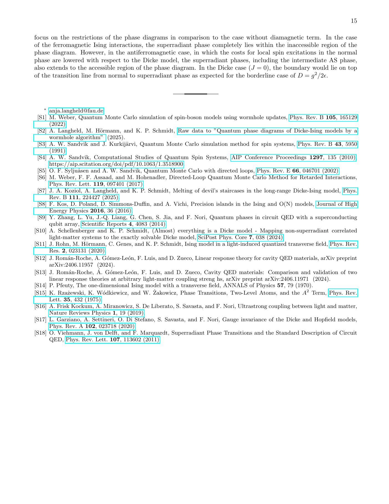

反铁磁 $J>0$ 会降低完全极化 PN 态中的局域翻转代价。设初态所有自旋 $\sigma^z=-1$。翻转一个自旋：

- 纵场从 $-\epsilon$ 变为 $+\epsilon$，代价 $2\epsilon$；
- 它与每个仍朝下邻居的反铁磁键从 $+J$ 变为 $-J$，每条键释放 $2J$；
- 配位数为 $z$ 时，最简单的局域估计为

$$
\Delta_{\rm loc}\approx2\epsilon-2zJ=2(\epsilon-zJ).
$$

因此靠近 PN→AN 失稳处，物质体系对 $x$ 向扰动的静态响应比独立自旋更强。光场不必克服纯 Dicke 模型中的完整 $2\epsilon$ 能标，就可能诱导横向极化。$A^2$ 项抑制的是光子侧，而反铁磁关联增强的是物质侧响应；二者竞争后，AS 和 PS 的部分区域仍可落在虚线以上的可达区。

这正对应原文补充材料第 S15 页的解释：“normal phase 中局域自旋激发代价相对 Dicke 模型降低”。但原文没有给出上面的单翻转公式，也没有从多体响应函数推导新的临界条件，所以该公式属于我们的机制性分析。

#### 更系统的失稳条件应怎样建立

在正常相附近，可把光子位移 $X\propto\langle a+a^\dagger\rangle$ 视为作用在物质系统上的均匀 $x$ 向场。物质的二阶能量响应由零频均匀横向磁化率 $\chi_{xx}(q=0,\omega=0)$ 决定；光子部分提供正的刚度。超辐射失稳发生在“重整化光子刚度”与“$g^2\chi_{xx}$ 带来的负曲率”刚好抵消时。示意地可写成

$$
K_{\rm ph}(D,\omega)-C\,g^2\chi_{xx}(J,\epsilon)=0,
$$

其中常数 $C$ 取决于 $X$ 和磁化的归一化约定。纯 Dicke 模型的 $\chi_{xx}$ 由独立两能级系统决定；反铁磁关联使它在磁失稳附近增强，从而降低所需的 $g_c$。要形成可发表的定量结论，下一步应从本文符号严格推导 $K_{\rm ph}$、$C$ 和有限 $J$ 的 $\chi_{xx}$，而不能停留在 $\Delta_{\rm loc}$ 估计。

#### no-go 结论的适用边界

作者写的是“在某些实现中”TRK 给出上述下界，并用它作说明。真实平台还需要检查：

1. 两能级截断与 $A^2$ 项是否规范一致；
2. $g$、$D$、$\epsilon$ 是否来自同一微观模型；
3. 耦合是电偶极、磁偶极还是电路有效耦合；
4. 所讨论的是物理平衡超辐射相，还是量子模拟器中的有效哈密顿量基态。

所以本文支持的准确表述是：“在作者采用的 TRK 约束示例下，反铁磁相互作用可让超辐射相的部分区域保持可达。”它不是“反铁磁作用普遍绕过所有 no-go 定理”的证明。

- 个人想法：
- 问题：为什么加入 TRK 约束项后，反铁磁超辐射相仍可能可达？文献中说明了吗？
- 当前回答：说明了，但只给出上述定性物理机制；定量的含 $J$ 失稳条件仍需另行推导。

## 个人批注与开放问题

> 本节保留用户主动提出的问题、联想和后续研究任务；上方精读正文用于保存已经核对过的原文、截图与分析。以后追加内容时只做局部增补，不覆盖用户在本地写入的文字。

### 用户问题记录 1：加入 TRK 约束后，反铁磁超辐射相为何仍可能可达？

- 原文定位：补充材料第 S14–S15 页，式（S33）–（S35），图 S9 及其后两段讨论。
- 论文报告：加入 `H_{A²}=D(a†+a)²` 后，可通过 Bogoliubov 变换将参数映射为 `ω′=√(ω²+4ωD)`、`g′=g√(ω/ω′)`。作者取示例性的 TRK 下界 `D=g²/(2ε)` 后，图 S9 显示铁磁超辐射区完全落入不可达区域，但反铁磁超辐射相（包括 AS 共存相）仍有一部分位于可达区域。
- 作者解释：论文在补充材料第 S15 页明确说明，反铁磁情形下，正常相中的局域自旋激发代价相对于纯 Dicke 模型降低，因此超辐射相能够延伸到 TRK 约束下的可达区域。
- 分析补充（非论文在 §IV 中逐式给出的推导）：在完全极化的顺磁正常相中，按本文符号将一个自旋从 `σᶻ=-1` 翻到 `σᶻ=+1`，纵场能量增加 `2ε`，但每条与反铁磁邻居相连的键从 `+J` 降到 `-J`，每键降低 `2J`。若配位数为 `z`，简单局域激发估计为 `Δ_loc≈2(ε-zJ)`，小于纯 Dicke 模型的 `2ε`。因此靠近反铁磁失稳线时，自旋横向磁化率增大，光场诱导有序所需的临界有效耦合下降；即使 `A²`/TRK 约束提高了光子刚度，物质侧增强的响应仍可能使超辐射相界进入可达区域。这个估计说明机制，但不能代替完整的关联体系失稳条件。
- 我的想法：
- 问题：为什么加入 TRK 约束项后，反铁磁超辐射相仍可能可达？文献是否给出了说明？
- 当前回答：文献给出了上述定性物理解释，但没有在 §IV 中进一步推导一个显式的、含 `J` 的受约束临界条件来量化“激发代价降低”如何抵消 `A²` 项造成的抑制。
- 待核对：结合正常相的自旋激发隙或静态横向磁化率，推导超辐射失稳条件；核对反铁磁 `J>0` 如何提高相关响应并降低临界 `g`，再与 `D≥g²/(2ε)` 的可达边界逐项比较。还需确认该 TRK 下界适用于哪类微观实现，不能直接推广到所有电路或磁偶极平台。

### 用户问题记录 2：反铁磁作用是否能够对抗 $A^2$ 项并突破 no-go 定理？

- 用户原话：“也就是说反铁磁是可以对抗 A² 项的吗，使得平衡态系统依然能突破 no-go 定理吗，从而实现超辐射相变？”
- 简短结论：在本文研究的有效 Dicke–Ising 模型及其采用的 TRK 下界下，反铁磁关联确实能够把临界耦合降到可达区，使含 $A^2$ 项的有效平衡哈密顿量仍具有超辐射基态。但本文没有证明任意真实、规范一致的微观腔 QED 系统都能普遍突破 no-go 定理。
- 论文报告：补充材料图 S9(b) 显示 AS 和 PS 超辐射相的一部分位于 TRK 可达区；第 S15 页把原因解释为反铁磁相互作用降低正常相中的局域自旋激发代价。
- 分析补充：反铁磁作用并没有抵消或删除 $A^2$ 项。$A^2$ 仍增大光子刚度；反铁磁作用发生在物质侧，通过减小激发能和增大横向磁化率降低超辐射临界耦合。两种效应竞争后，临界线可能落到 TRK 允许的一侧。
- 对“突破 no-go”的准确表述：这可以称为在特定相互作用物质模型中避开纯 Dicke no-go 结论，或展示一个可能的相互作用诱导通道；不能据此宣称违反了规范不变性或普遍 no-go 定理。标准 no-go 定理的假设已经因物质间相互作用和相应响应函数改变。
- 真实平衡系统所需的额外验证：必须从同一个规范一致的微观模型同时推导 $g$、$D$、$J$、能级截断及耦合算符，并证明完整多能级体系仍出现热力学极限的基态非解析性。本文没有给出这样的具体实验平台证明。
- 量子模拟器边界：若实验工程出有效 Dicke–Ising 哈密顿量并观察其超辐射基态，这是有效哈密顿量的基态性质；除非其全部参数满足真实电偶极系统的微观约束，否则不应称为突破自然腔 QED 的基本 no-go 定理。
- 关于“数值模拟已经实现”的澄清：这一判断是正确的。作者用无偏 QMC 计算平衡 Dicke–Ising 哈密顿量的基态相图，并通过系统尺寸标度确认超辐射序和量子相变；含 $A^2$ 的结果没有重新显式采样 $D(a^\dagger+a)^2$，而是利用式（S35）的精确 Bogoliubov 参数映射把既有 QMC 相图转换到含 $A^2$ 的模型，再用图 S9 检查 TRK 可达性。因此数值证据确立的是“该受约束有效平衡模型存在可达的超辐射相”，不是实验室已经实现了相变。
- 状态：部分回答。模型层面结论明确；真实微观平台层面的可实现性仍开放。

### 用户问题记录 3：无偏的虫洞量子蒙特卡洛算法目前用得多吗，靠谱吗？

- 用户原话：“无偏的虫洞量子蒙特卡洛算法目前用的多吗，靠谱嘛？”
- 简短结论：**目前不算用得多，但在它擅长的模型范围内是靠谱的。** 更准确地说，它是一个 2022 年正式发表、建立在成熟的随机级数展开（SSE）和定向环（directed-loop）方法之上的年轻专用算法；它还不是像常规 SSE、辅助场/行列式 QMC 或连续时间 QMC 那样被很多独立团队广泛使用的通用标准工具，但已经产生了数篇同行评议的非平凡应用，因而也不是只在单篇论文里出现、未经检验的技巧。

#### “无偏”究竟是什么意思

- Weber（2022，Phys. Rev. B **105**, 165129，DOI: [10.1103/PhysRevB.105.165129](https://doi.org/10.1103/PhysRevB.105.165129)）在第 III 节、式（18）先把二次型玻色自由度精确积分掉，得到虚时间上的延迟自旋相互作用；第 IV 节再用连续时间的 SSE/定向环框架采样，并让环从延迟顶点的一端通过“虫洞”跳到另一端。这里的“exact/unbiased”主要表示：不做平均场、微扰或变分近似，不截断无界玻色 Hilbert 空间，也没有 Trotter 时间离散误差。
- 它**不表示计算结果没有任何误差**。输出仍有蒙特卡洛统计误差、自相关和热化误差，还必须控制有限温度 $\beta^{-1}$、有限系统尺寸和外推窗口。若模型出现符号问题，采样效率会指数恶化；原算法第 VI.B 节也明确把“Monte Carlo 权重为正”作为适用条件，并指出某些带玻色跳跃的极化激元模型可能产生负权重。
- 因而更严格的说法是：**在权重非负、更新遍历且收敛检查充分的前提下，它给出给定有限尺寸、有限温度模型的统计意义上的数值精确结果；从有限系统推到基态热力学极限仍需标度分析。**

#### 使用广度：正在增长，但仍属小众专用方法

- 原始方法论文是 Weber（2022）。随后可核对的应用包括：耗散 Heisenberg 链的无近似大规模 QMC（Weber、Luitz、Assaad，2022，Phys. Rev. Lett. **129**, 056402，DOI: [10.1103/PhysRevLett.129.056402](https://doi.org/10.1103/PhysRevLett.129.056402)）；SU(2) 对称 spin-boson 模型的高精度临界分析（Weber、Vojta，2023，Phys. Rev. Lett. **130**, 186701，DOI: [10.1103/PhysRevLett.130.186701](https://doi.org/10.1103/PhysRevLett.130.186701)）；耗散 Bose–Hubbard 模型的连续时间 wormhole 推广（Ribeiro 等，2024，Phys. Rev. B **110**, 115145；预印本 [arXiv:2311.07683](https://arxiv.org/abs/2311.07683)）；本文的 Dicke–Ising 相图（Langheld、Hörmann、Schmidt，2025，Phys. Rev. B **112**, L161123，DOI: [10.1103/lcvj-ksct](https://doi.org/10.1103/lcvj-ksct)）；以及各向异性 spin-boson 模型中的伪临界行为（Weber，2025，Phys. Rev. B **112**, 235153，DOI: [10.1103/mtq7-n96c](https://doi.org/10.1103/mtq7-n96c)）。长程 Dicke–Ising 推广目前还可见于 Koziol、Langheld、Schmidt（2025，[arXiv:2503.02734](https://arxiv.org/abs/2503.02734)）。
- 从这些论文可以判断：方法已经跨越单杂质、耗散自旋链、玻色晶格和全局光子模等不同问题，说明可移植性是真实的；但使用者与合作者仍较集中，独立实现和跨团队复现实例还不算多。后一句是根据目前原始文献分布作出的判断，不是某篇论文自称的结论。

#### 为什么认为算法本身可信

1. **建立在成熟框架上。** 它不是全新定义一种概率采样，而是把 SSE/定向环对瞬时顶点的全局更新推广到延迟顶点；局部散射概率仍由定向环方程构造，并满足详细平衡。
2. **玻色自由度被解析积分，而非人为截断。** 对本文的单个谐振光子模，这是重要优势：不会因为选择最大光子数 $n_{\max}$ 而移动相界。
3. **原始算法有独立方法交叉。** Weber（2022）第 V 节、图 5 得到的临界耦合与变分 MPS 结果一致，并能达到此前 QMC 难以达到的低温；这验证了更新和观测量实现，但不是对所有模型的一次性证明。
4. **本文补充材料有可量化基准。** 图 S4(a) 的一阶转变给出 $g_{\times,L}=0.409062(9)$、热力学外推 $g_{\times,\mathrm{tdl}}=0.409019(8)$，与精确值约 $0.409044$ 一致；图 S4(b) 的连续转变得到 $\nu'=1.4950$、$\beta=0.4687$、$g_c=0.70712$，接近期望值 $3/2$、$1/2$、$1/\sqrt2$。这是本文代码和标度流程最直接的可信度证据。
5. **本文做到了大尺寸。** 主文报告最大 $N=8192$；这显著降低了把普通有限尺寸漂移误判为相变的风险，但不能自动解决多临界点附近的弱一阶与长自相关问题。

#### 哪些地方仍需特别谨慎

- **符号问题是模型依赖的。** “wormhole”不是消除所有符号问题的魔法；必须逐个模型证明权重非负。
- **一阶相变附近可能卡相。** 两个亚稳态之间的隧穿概率很低，需要双向参数扫描、不同初态、能量分支/直方图和足够长的热化；本文用 energy crossing 和 swipe protocol 处理，但多临界端点附近仍最难判断。
- **弱一阶与伪临界会伪装成连续标度。** Weber（2025）恰好展示了临界指数可能发生极慢漂移。因此看到漂亮的数据塌缩还不够，还要改变最小尺寸、拟合窗口和 $\beta(L)$ 检查稳定性。
- **“数值精确”只针对写下来的有效哈密顿量。** 它不能消除两能级截断、遗漏模式、$A^2$/TRK 参数关系或真实实验平台建模所带来的系统误差，也不直接描述受驱动开放系统的稳态动力学。

#### 对本文结论的可信度分级

- **较高可信度：** Dicke–Ising 有效平衡哈密顿量中各相的存在、远离端点处的相界趋势、连续 Dicke 临界线，以及图 S4 覆盖的基准区域。
- **中等且需保留误差意识：** 多临界点的精确位置、弱一阶区与连续区的分界、二维 AS–PS 端点附近的临界指数；这些正是有限尺寸和伪临界最敏感的区域。
- **条件性结论：** 图 S9 中含 $A^2$/TRK 的“可达区”主要依赖精确 Bogoliubov 参数映射和既有 QMC 相图，模型内部可信；能否对应某个真实平衡腔 QED 平台，则需要额外的规范一致微观推导，不能由 QMC 的“无偏”自动保证。
- 实务判断：可把本文 wormhole QMC 当作毕业设计中的高质量数值基准，但如果要复现或据此提出新相区，应至少补做小尺寸精确对角化、$\beta$ 收敛、尺寸窗口漂移、独立随机种子、binning/自相关时间，以及一阶区的双向扫描。
- 当前回答：**算法在适用域内靠谱，但尚不是广泛普及、可无条件套用的黑箱工具。**

### 用户问题记录 4：虫洞 QMC 的计算量是否高于张量网络？

- 用户原话：“这个算法的计算量会比张量网络那套高吗？”
- 简短结论：**不能笼统地说虫洞 QMC 比张量网络更贵。对本文要做的无符号问题、大尺寸平衡相图，虫洞 QMC 通常比通用张量网络更容易扩展，二维尤其如此；对一维中等尺寸的少数基态点，MPS/DMRG 可能更省；若目标是波函数、纠缠或实时动力学，张量网络提供的信息更多，也往往更合适。**

#### 两种方法真正控制计算量的参数不同

本文补充材料第 I.2 节明确给出其实现的单次基本采样复杂度

$$
C_{\mathrm{QMC,sweep}}=\mathcal O\!\left(\beta N\log\beta\right),
$$

其中 $N$ 是自旋数，$\beta$ 是逆温；$\log\beta$ 来自每个格点上的顺序统计树和有序映射。总运行量还应示意地写成

$$
C_{\mathrm{QMC,total}}
\sim C_{\mathrm{QMC,sweep}}\,M\,\tau_{\mathrm{int}},
$$

这里 $M$ 是为了达到目标统计误差所需的独立样本量，$\tau_{\mathrm{int}}$ 是积分自相关时间。论文只给出了前一个算法复杂度，并未声称后两个因子恒定；临界点和一阶共存区可能使它们显著增大。作者仍能做到 $N=8192$，说明对本文参数范围其实际缩放相当好。

对一维 MPS/DMRG，一个常见的单次 sweep 粗略估计是

$$
C_{\mathrm{MPS,sweep}}
\sim \mathcal O\!\left(ND_{\mathrm{MPO}}d\chi^3\right),
$$

但这一式只用于理解趋势：$d$ 是局域 Hilbert 空间维数，$D_{\mathrm{MPO}}$ 是哈密顿量 MPO 的键维数，$\chi$ 是态的键维数，具体幂次取决于单站点/双站点更新、对称性和收缩方案。MPS 的关键不是表面上的 $N$，而是达到目标精度所需的 $\chi$。一维有隙、低纠缠基态通常只需较小 $\chi$，因而非常高效；临界、长程耦合或二维圆柱加宽时，$\chi$ 会迅速增长。

若在 MPS 中显式保留光子模，还需给无界 Fock 空间选择 $n_{\max}$ 或优化玻色基，等效地使光子站点具有较大的 $d_{\mathrm{ph}}$。虫洞 QMC 把二次型光子精确积分掉，完全没有这一截断。另一方面，专门的优化玻色基、链映射或拆分局域 Hilbert 空间可以大幅改善 MPS，因此不能把朴素的 $n_{\max}$ 实现当作所有张量网络的上限。参见 Schollwöck（2011，DOI: [10.1016/j.aop.2010.09.012](https://doi.org/10.1016/j.aop.2010.09.012)）对 MPS/DMRG 的系统综述，以及 Kamar、Maghrebi（2024，DOI: [10.1103/PhysRevB.110.075114](https://doi.org/10.1103/PhysRevB.110.075114)）对大局域玻色维数问题的处理。

#### 针对不同任务的实际判断

| 任务 | 通常更有优势 | 原因 |
| --- | --- | --- |
| 一维、有隙、少量基态参数点 | MPS/DMRG 常常更省 | 低纠缠使所需 $\chi$ 较小；直接得到近似基态，无统计噪声 |
| 一维临界区的大尺寸有限尺度标度 | 本文的虫洞 QMC 往往更省 | 成本对 $N$ 近线性；无需光子截断，但要控制 $\beta$ 和自相关 |
| 二维方格晶格、权重非负的静态相图 | 虫洞 QMC 明显更有扩展性 | PEPS 收缩和优化成本随键维数很高；QMC 可直接做到大面积晶格 |
| 有严重符号问题或受挫模型 | 张量网络可能更可行 | QMC 的平均符号可能指数衰减；张量网络没有蒙特卡洛符号问题，但仍受纠缠限制 |
| 波函数、纠缠谱、局域激发 | 张量网络 | QMC 主要给期望值与虚时间关联，不直接输出多体波函数 |
| 实时动力学 | 张量网络通常优先 | 平衡虚时间 QMC 不能直接给实时间；MPS 受纠缠随时间增长限制，但至少可直接演化 |
| 有限温静态量和热力学扫描 | 无符号时 QMC 常有优势 | QMC 原生采样有限温配分函数；MPO 热态也可做，但会增加纯化/算符纠缠成本 |

#### 针对本文的最终判断

- **若目标是复现整张一维和二维 Dicke–Ising 相图及临界标度：**虫洞 QMC 大概率比通用 MPS/PEPS 更划算；$N=8192$ 和二维 $30\times30$ 是实际证据，而不只是复杂度公式上的判断。
- **若只验证一维少数参数点：**MPS/DMRG 很可能更快上手，并可直接与 QMC 做独立交叉验证；需要同时报告 $\chi$、光子截断/优化基和截断误差。
- **若采用无限 MPS 或先把热力学极限的集体光场转化为自洽物质场：**某些一维基态问题可能比有限尺寸 QMC 更便宜，但这已经利用了额外的热力学极限结构；它不等价于本文保留有限 $N$ 涨落并做有限尺度标度的任务。
- **不能只比一次 sweep：**QMC 的结果是带统计误差的观测量；MPS 的一次优化会得到一整个近似波函数。因此若需要很多不同观测量、纠缠或激发信息，张量网络一次计算的“信息产出”可能更高。
- 当前回答：**就本文的静态大尺寸相图而言，虫洞 QMC 的总计算负担通常不会高于张量网络，二维往往低得多；但在一维低纠缠基态、小中等尺寸和波函数型任务上，张量网络可能更高效。**

### 用户判断记录 5：虫洞 QMC 的真正优势、非临界区近似方法与 TC 模型适用性

#### 读者原话

> 关于这种算法；实际上虽然这种方法能计算临界耦合点的标度等，但是实际上在非临界耦合点就不再依赖这种方法，很多其他的方法也能算。在非临界点，就算传统的平均场可能没法定量地给出结果，但实际上平均场还是有可能定量地解决。因为最近我在算的是一个tc耦合的特定模型，跟这个有点类似，在tc耦合下绝热消除或者平均场近似的定量精确性依赖于大失谐的条件。如果不是大失谐就是能预测相不能精确定量计算，跟这个差不多，但是采用某种修正方法，实际上还是能解决，也能定量计算，，dicke的我还没算，但在非临界点也应该能算。更不用说还有很多数值方法也能算非临界点的。
>
> 另外虫洞算法并且也继承了QMC量子蒙卡的符文问题等，应用范围很有限。例如没法算tc耦合的模型。可以说这种方法就是专门来算这种dicke耦合临界点的。我查了下应用，好像也就是论文作者他们的团队和合作者在用。所以是个很强的方法，但应用范围还是有点窄。

> 注：上文“符文问题”按上下文理解为“符号问题”，其余表述按读者原话保留。

#### 总体评价

这个判断的主干是成立的：**wormhole QMC 的边际价值在临界区、强涨落区以及需要无偏基准时最高；在一个有能隙、远离相界且存在受控小参数的相内部，绝热消除、Schrieffer–Wolff 展开、自洽平均场、Gaussian/RPA 修正、张量网络或小系统精确对角化等方法都可能以更低代价给出定量结果。** “强但适用面窄、目前使用团队集中”也是合理的文献观察。

不过需要作三点重要修正。

#### 修正一：“远离临界点”本身不保证裸平均场定量精确

远离连续临界点通常意味着能隙有限、关联长度有限，因而更容易建立局域或低阶展开；但定量精度仍取决于是否存在明确的小参数，例如：

$$
\eta_{\mathrm{disp}}
\sim \frac{\Vert V\Vert}{\Delta_{\min}}\ll1,
$$

其中 $V$ 是被微扰处理的光–物质耦合，$\Delta_{\min}$ 是相关虚跃迁的最小能量分母。对 TC/JC 型模型，在固定激发扇区和给定归一化下，这可能表现为 $g/\Delta$、集体增强后的 $g_{\mathrm{coll}}/\Delta$，或更具体的矩阵元与失谐之比；必须由实际哈密顿量定义，不能预先把所有模型都写成同一个 $g/\Delta$。

- 大失谐使绝热消除或 Schrieffer–Wolff 展开成为受控近似；保留更高阶项、做自洽重整化或数值校准后，确实可能在非临界区达到定量精度。
- 仅仅“不是临界点”并不能保证传统平均场精确。在一维或低配位系统中，即使相内有隙，局域量和关联函数仍可能受到显著量子关联修正。
- 一阶相变是特别的反例：相内两侧都可以有有限关联长度，但相界由两个宏观态极小的能量差决定。每个相的平均场能量看似都很准，微小的系统误差仍可能明显移动能量交叉点。
- 因而应把“能预测是什么相”和“能定量预测序参量、能量、关联函数及相界位置”分开验证。

这也与 Langheld、Hörmann、Schmidt（2025）主文图 3、4 的结构一致：变分平均场背景图能给出不少相图拓扑和趋势，但 QMC 改变了部分相变阶数、端点和相界的定量位置。论文报告的是该具体模型中的比较，不能反过来推出所有非临界点的平均场都不准或都准确。

#### 修正二：wormhole QMC 不只在临界点有用

该方法不只用于提取临界耦合与临界指数。它还能：

- 在完整参数区给出无偏的能量、序参量、静态响应和有限温结果；
- 为平均场、绝热消除、高阶有效哈密顿量及张量网络提供基准；
- 识别近似方法是否漏掉中间相、误判一阶/连续转变，或在深相内产生系统偏差；
- 处理显式玻色截断困难、但玻色部分为二次型且积分后权重仍非负的模型。

因此更合适的定位不是“只有临界点才能用”，而是：**深相内往往没必要为每个问题都付出无偏 QMC 的实现与采样成本；临界区和近似失控区最能体现它不可替代的价值。**

#### 修正三：“不能算 TC 耦合”说得过强

Weber（2022，Phys. Rev. B **105**, 165129，DOI: [10.1103/PhysRevB.105.165129](https://doi.org/10.1103/PhysRevB.105.165129)）原始算法论文已经显式讨论 Jaynes–Cummings（JC）耦合。其式（6）写出

$$
H_{\mathrm{JC}}
=-h_zS_z+\sum_q\omega_q a_q^\dagger a_q
+\sum_q\gamma_q\left(a_q^\dagger S_-+S_+a_q\right),
$$

积分掉二次型玻色模后，式（20）得到有方向的延迟自旋翻转作用

$$
\mathcal H_{\mathrm{ret}}^{\mathrm{JC}}
=-\frac1\pi\int d\omega\,J(\omega)
\int_0^\beta d\tau\,d\tau'\,
S_+(\tau)D(\omega,\tau-\tau')S_-(\tau').
$$

论文第 VI 节还明确说该 QMC 方法是为 XXZ spin-boson 和 Jaynes–Cummings 模型构造的。TC 模型是多个自旋耦合到共同单模的 JC 推广，所以从作用量结构看，**单模 TC 并不在原理上被 wormhole 框架排除**；需要针对全局 $S_+DS_-$ 顶点重新求解定向环方程、实现更新并检查权重正定性。

必须区分以下三句话：

1. **Langheld 等本文公开描述的 Dicke–Ising 实现不能原封不动地计算 TC 模型。** Dicke 顶点是 $\sigma_i^xP_{\mathrm{sym}}\sigma_j^x$，而 TC 顶点具有 $S_+DS_-$ 的方向和 U(1) 激发数结构，代码与估计量都需修改。
2. **wormhole 方法原则上不能计算 TC 模型。** 这句话缺乏依据，且与 Weber（2022）的 JC 构造相冲突。
3. **某些更复杂的 TC/JC 晶格推广可能出现符号问题。** 这句话成立。Weber（2022）第 VI.B 节特别指出：对 Jaynes–Cummings–Hubbard 型模型，积分掉带空间跳跃的玻色子后，非局域传播子可能含负贡献，作者预期其 wormhole 表述会有符号问题；这与单个共同光子模的 TC 模型不是一回事。

#### 对方法适用范围的更准确表述

虫洞更新不是“专门计算 Dicke 临界点”的算法，而是**对玻色自由度积分后产生的延迟相互作用进行全局更新的一类专用 QMC 技术**。Dicke–Ising 是它的一个重要应用。它已经用于多浴 spin-boson、耗散自旋链、耗散 Bose–Hubbard、Dicke–Ising 等问题，但目前文献确实主要集中在 Manuel Weber、Langheld/Schmidt 及其合作者附近，独立团队采用较少。因此，“方法很强，但生态小、实现门槛高、模型适配窄”是比“只能算 Dicke 临界点”更准确的总结。

#### 对当前 TC 项目的直接启示

建议把近似方法的有效性按三层分别检验：

| 层次 | 要回答的问题 | 推荐验证 |
| --- | --- | --- |
| 相的定性识别 | 哪个序参量非零、对称性怎样破缺 | 平均场/绝热消除与小系统 ED 对照 |
| 相内定量结果 | 能量、光子数、占据、关联函数有多准 | 扫描失谐，比较裸近似、修正方法与 ED/MPS；报告相对误差 |
| 相界与临界性质 | 临界耦合、相变阶数、指数是否正确 | 有限尺寸标度；用无偏数值或多个独立方法交叉验证 |

特别应画出误差随控制参数的图，而不是只给“大失谐/非大失谐”的二分判断，例如

$$
\delta_O(\eta)
=\frac{\left|O_{\mathrm{approx}}(\eta)-O_{\mathrm{benchmark}}(\eta)\right|}
{\max\!\left(\left|O_{\mathrm{benchmark}}(\eta)\right|,O_{\mathrm{floor}}\right)}.
$$

这样可以定量回答：裸绝热消除在哪个 $\eta$ 范围有效、修正方法把有效范围推进了多少、误差是否在靠近相界前就开始增长。

- 当前状态：**部分赞同并完成关键修正。** “非临界区常有更便宜且可定量的受控方法”“wormhole QMC 应用生态较窄”成立；“非临界就足以保证平均场定量准确”“wormhole 原理上不能处理 TC”“它只用于 Dicke 临界点”不成立或表述过强。
- 待核对：将读者正在计算的具体 TC 哈密顿量、耦合归一化、激发扇区、失谐定义和修正方案写清后，确定真正的小参数及理论误差阶数；再判断该模型的 wormhole 权重是否非负，而不能只凭“TC”名称判断。

### 用户问题记录 6：非临界点与临界点一般使用不同的计算方法吗？

- 用户原话：“一般我们计算的时候非临界点和临界点处用的计算方法一般不一样吗？”
- 简短回答：**不一定更换底层求解器，但几乎一定要更换精度要求、收敛策略和数据分析方法。** 实际研究常见两种路线：一是用同一个无偏数值方法扫描全参数区，在临界区增加尺寸、逆温和统计量并做有限尺度标度；二是深相区使用便宜的受控近似，在临界窗口切换到 QMC、张量网络或其他高精度方法，并在两者重叠区域交叉验证。

#### 为什么非临界区通常容易

对普通短程、有隙体系，若与临界点有有限距离，通常存在有限关联长度 $\xi$ 和有限最低能隙 $\Delta$。基态数值只需满足

$$
L\gg\xi,\qquad \beta\Delta\gg1,
$$

便可显著压低有限尺寸和有限温修正。此时往往可以利用：

- 小参数微扰、Schrieffer–Wolff 变换或绝热消除；
- 平均场加 Gaussian/RPA、$1/N$ 或自洽修正；
- 较小键维数的 MPS/DMRG；
- 较小系统的精确对角化或截断基计算。

这里仍有模型依赖：长程或全连接模型的有限尺寸修正未必是普通的 $e^{-L/\xi}$；“有隙”也不自动保证裸平均场定量精确。

#### 临界点为什么需要不同的数值处理

连续临界点附近

$$
\xi\sim|\lambda-\lambda_c|^{-\nu},\qquad
\Delta\sim\xi^{-z},
$$

因此在热力学极限中 $\xi$ 发散、能隙闭合。有限系统中通常有 $\Delta_L\sim L^{-z}$，若要逼近基态需随尺寸增加逆温，例如取 $\beta\propto L^z$。观测量不能只看单个大系统，而要使用类似

$$
O(L,\delta)
=L^{-x_O}\mathcal F\!\left(\delta L^{1/\nu}\right),
\qquad \delta=\lambda-\lambda_c,
$$

的有限尺度标度、交叉点、Binder 比、关联长度比或数据塌缩。本文 Dicke 临界性高于上临界维，使用的是修正后的伪相关长度指数 $\nu'=3/2$，不能机械套用普通短程模型的 $\nu$。

临界区还会带来：

- QMC 临界慢化、自相关时间增长和更低温要求；
- MPS 所需键维数随临界纠缠增长；
- 小系统 ED 的伪临界点明显漂移；
- 微扰展开中的小能量分母或平均场涨落修正变大。

所以即使底层仍是同一个 QMC 或 DMRG，**计算预算和判据已经相当于另一套工作流程**。

#### 一阶相变需要单独分类

一阶相变处关联长度未必发散，不能简单归入上述连续临界标度。主要困难是两相能量交叉、亚稳态和隧穿困难。常用方法是：

- 分别从两侧初态追踪两个能量分支；
- 双向扫描、滞回和概率直方图；
- 比较自由能或基态能量交叉；
- 检查序参量和能量是否出现随尺寸变尖锐的跳变。

因此“一阶临界点附近”未必需要连续临界指数，但可能比深相区更难采样、更要求能量精度。

#### 常见的方法选择

| 参数区域/目标 | 是否必须换求解器 | 通常需要改变的内容 |
| --- | --- | --- |
| 深处于有隙相，只求能量和序参量 | 否；常可换成更便宜近似 | 检查小参数、截断误差和与基准的偏差 |
| 接近连续临界点 | 不一定 | 增大 $L,\beta,\chi$ 或样本数；做有限尺度标度而非单点判断 |
| 一阶相界 | 不一定 | 两相能量分支、双向扫描、亚稳态和直方图分析 |
| 求临界指数/普适类 | 通常需要无偏或系统可控的方法 | 多尺寸、多参数点、误差传播和拟合窗口稳定性 |
| 只判断相图拓扑 | 可以组合方法 | 平均场初筛，高精度方法核对可疑边界和中间相 |

#### 对当前 TC 项目的建议

可以采用三级工作流：

1. **大失谐深相区：**用绝热消除或平均场及其修正，快速扫描参数并给出定量结果。
2. **中等失谐过渡区：**用 ED/MPS 或直接含光子模型作为基准，确定修正方法的误差随 $g/\Delta$ 如何增长。
3. **相界窗口：**如果目标只是临界耦合，做多尺寸交叉和漂移外推；如果还要判断相变阶数或普适类，则必须加入序参量标度、能隙/关联长度和一阶诊断。

方法切换时应保留一个重叠参数窗口，用两种方法计算同一组可观测量；否则近似误差可能被误认为物理交叉或相变。

- 当前状态：已回答。

## 关键公式与符号换算

| 原文位置 | 原文符号 | 本项目符号 | 定义与单位 | 适用条件/近似 | 备注 |
| --- | --- | --- | --- | --- | --- |
| 主文式（1） | $\omega,\epsilon,g,J,N$ | 暂沿用原文 | 光子频率、自旋半劈裂、集体耦合、Ising 耦合、自旋数；$\hbar=1$ | 平衡、封闭的 Dicke–Ising 有效哈密顿量 | $J<0$ 铁磁，$J>0$ 反铁磁 |
| 主文式（2） | $P(\tau-\tau')$ | 玻色延迟核 | 积掉光子后连接两个虚时间端点 | 高斯光子模被精确积分；有限温周期边界 | 不是瞬时 Ising 相互作用 |
| 补充式（S35） | $\omega',g',D$ | 暂沿用原文 | $\omega'=\sqrt{\omega^2+4\omega D}$；$g'=g\sqrt{\omega/\omega'}$ | 加入抗磁 $A^2$ 项并作 Bogoliubov 变换 | $D$ 的微观约束依平台而定 |
| 本笔记机制估计 | $\Delta_{\mathrm{loc}}$ | 局域翻转代价 | $\Delta_{\mathrm{loc}}\approx2(\epsilon-zJ)$ | 从完全极化正常态作单翻转、配位数为 $z$ | 本文分析，不是原文公式 |

## 关键图表

| 图号 | 参数 | 图中结论 | 相变判据 | 我的疑问/备注 |
| --- | --- | --- | --- | --- |
| 图 3 | 铁磁 $J<0$ | 小 $\epsilon$ 一阶，大 $\epsilon$ 连续 Dicke 转变 | 能量交叉、序参量、有限尺度标度 | 多临界区需关注弱一阶效应 |
| 图 4 | 反铁磁 $J>0$；链与方格晶格 | AN、PN、AS、PS 四相；维数改变 AS–PS 边界性质 | 交错序、Binder 比、光子密度 | 不把 AS–PS 连续线误归为 Dicke 普适类 |
| 图 S4 | 文中两个铁磁基准点 | 一阶交叉与连续数据塌缩均获验证 | 滞回/能量分支；$\nu',\beta$ 塌缩 | 数值与精确/期望值一致 |
| 图 S5–S8 | 方格晶格 AS–PS 邻域 | 连续段约在 $g/\omega<0.30(2)$，之后为一阶 | Binder、能量和临界指数 | 端点附近弱一阶难判 |
| 图 S9 | 含 $A^2$ 项并取 TRK 等号 | 铁磁超辐射不可达，反铁磁超辐射仍部分可达 | 重整化参数后的相界与可达边界比较 | 需要推导含 $J$ 的定量失稳条件 |

## 与毕业设计的关系

### 可直接作为基线的内容

- 式（1）的平衡 Dicke–Ising 哈密顿量、四类反铁磁相的命名和相界拓扑。
- Dicke 临界线的 $\nu'=3/2$ 有限尺度标度，以及二维 AS–PS 连续线的三维 Ising 指数。
- 不截断玻色 Hilbert 空间的 QMC 结果可作为后续近似或小系统对角化的基准。

### 不能直接沿用的内容

- 不能把封闭平衡模型的超辐射基态直接解释为受驱动开放腔的稳态相。
- 图 S9 的 TRK 下界不能无条件套到所有实验平台；必须从具体微观耦合和规范一致性出发核对。
- 不能把局域翻转估计当成完整的多体临界条件。

### 可能的研究切入点

- 从正常相的静态横向磁化率推导含 $J$ 的超辐射失稳条件，并与图 S9 的约束边界比较。
- 比较一维和二维反铁磁关联对临界耦合与 AS 共存区宽度的影响。
- 若研究开放系统，明确增加驱动、损耗和稳态判据，另立模型而不是直接复用本文相图。

## 待解决问题

- [ ] 推导含反铁磁 `J` 和 `A²`/TRK 约束的超辐射失稳条件，定量解释图 S9 中 AS/PS 相为何仍有可达区域。
- [ ] 若复现本文 QMC，建立一套最小验证协议：小尺寸 ED 对照、$\beta$ 与尺寸收敛、独立种子、binning/自相关分析，以及一阶区双向扫描和拟合窗口稳定性测试。
- [ ] 对当前 TC 特定模型写明哈密顿量与归一化，确定绝热消除/平均场的控制参数和误差阶数，并用 ED 或 MPS 绘制“误差—失谐—距相界距离”基准图。
- [ ] 若要判断 wormhole 是否适用于该 TC 模型，从积分玻色模后的 $S_+DS_-$ 权重、定向环顶点和可能的空间传播子逐项检查符号问题，而不是直接沿用 Dicke–Ising 代码。

## 可用于论文写作的已核结论

> 这里只收录已经回到原文核对过，并带有页码、公式或图号的结论。

- Langheld、Hörmann 与 Schmidt（2025）在主文图 3、4 报告：局域 Ising 相互作用可改变 Dicke–Ising 模型超辐射相界的位置和阶数，反铁磁模型还出现反铁磁序与超辐射序共存的 AS 相。
- 该文补充材料图 S5–S8 报告：二维方格晶格 AS–PS 边界在弱耦合段属于三维 Ising 普适类，并在 $g/\omega\simeq0.30(2)$ 附近转为一阶。
- 该文补充材料式（S33）–（S35）和图 S9 表明：在作者采用的 $A^2$/TRK 约束示例中，铁磁超辐射相不可达，但反铁磁超辐射相仍保留部分可达区域；作者将其归因于反铁磁耦合降低局域自旋激发代价。
- 推荐表述：对于本文研究的平衡 Dicke–Ising 有效模型，在作者采用的 $A^2$/TRK 约束下，反铁磁相互作用可使超辐射相在部分参数区域内保持可达；这一模型结果尚不能替代针对具体真实平台的规范一致微观可实现性证明。

## 阅读日志

| 日期 | 阅读范围 | 本次新增内容 | 下一步 |
| --- | --- | --- | --- |
| 2026-10-13 | 建立笔记文件 | 创建记录结构 | 逐步填写个人想法、问题和原文核对结果 |
| 2026-10-13 | 补充材料 §IV、式（S33）–（S35）、图 S9 | 记录 TRK 约束下反铁磁超辐射相仍可能可达的问题及作者的定性解释 | 从自旋激发隙或横向磁化率出发推导定量失稳条件 |
| 2026-10-15 | 主文及关键补充材料，步骤 1–11 | 将聊天中的逐段精读、原文截图、证据层级和项目关联统一写入本文件；截图迁入稳定资源目录 | 后续把个人批注直接追加到对应步骤，并继续完成含 $J$ 的失稳推导 |
| 2026-10-15 | 主文第 1–5 页与补充材料第 S1–S15 页 | 按对话中的讲解粒度重写：补充逐句研究逻辑、公式推导关系、读图方法、算法流程、数值证据和 TRK 响应机制 | 由正常相横向磁化率出发，完成带正确归一化系数的受约束失稳条件 |
| 2026-10-16 | 补充材料第 IV 节、式（S33）–（S35）与图 S9 | 补充第 IV 节逐段逻辑，并从裸参数到有效参数的映射推导“可达区”边界 $\epsilon/\omega=2(g/\omega)^2$ | 进一步核对具体实验平台中的 $D(g)$ 关系，再决定该边界能否直接采用 |
| 2026-10-17 | 补充材料第 IV 节与图 S9(b) | 记录“反铁磁是否突破 no-go”问题；区分有效模型可达性、真实平衡体系的规范一致微观证明和量子模拟器基态 | 选定候选平台后，从统一微观模型核对 $g,D,J$ 的相互约束 |
| 2026-10-17 | wormhole QMC 原始方法论文及 2022–2025 年代表性应用 | 评估算法使用广度、“无偏”的严格含义、基准证据、符号问题与有限尺寸/弱一阶风险，并给出本文结论的可信度分级 | 若决定复现，按待解决问题中的最小验证协议建立计算记录 |
| 2026-10-18 | 补充材料第 I.2 节及 MPS/DMRG 复杂度对照 | 比较 $\mathcal O(\beta N\log\beta)$ 的虫洞 QMC 与由 $\chi$、MPO 和玻色局域维数控制的张量网络，并按一维、二维、静态和实时任务给出选择建议 | 若开始数值复现，先用小尺寸 ED/MPS 与 QMC 做交叉基准，再决定主算法 |
| 2026-10-25 | 非临界区近似方法、TC/JC 适用性与符号问题 | 保留读者判断；区分“远离临界”与“存在受控小参数”，并依据 Weber（2022）式（6）、（20）修正“wormhole 不能处理 TC”的说法 | 写出当前 TC 模型，量化修正近似的误差范围，并检查积分玻色模后的权重符号 |
| 2026-10-25 | 非临界区、连续临界区与一阶相界的方法选择 | 说明底层求解器可以相同，但收敛条件、计算预算与标度/能量交叉诊断不同；给出 TC 项目的三级工作流 | 在当前 TC 模型中划定深相、过渡和相界三个验证窗口 |
